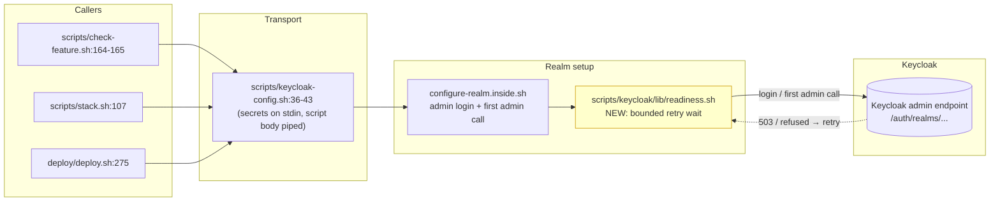
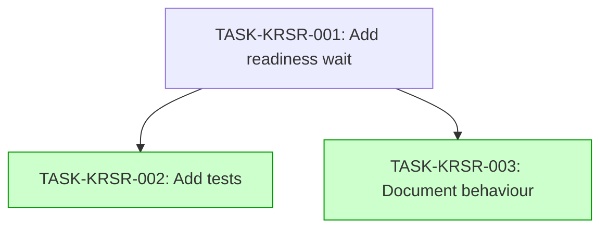

# Implementation Guide — Keycloak Realm Setup Readiness (FEAT-6AC9)

## Already done and still to do

- "the first admin login in the realm setup (scripts/keycloak/configure-realm.inside.sh, run by scripts/keycloak-config.sh for the checks, the local stack and every deploy)" — already done — `scripts/keycloak-config.sh:42` the realm setup is piped into `docker compose exec -T keycloak bash -s` by `scripts/keycloak-config.sh`, which the checks (`scripts/check-feature.sh:164-165`), the local stack (`scripts/stack.sh:107`) and the deploy (`deploy/deploy.sh:275`) all invoke.
- "never show the admin password on a command line" — already done — `scripts/keycloak-config.sh:36-43` secrets travel on the exec's stdin ahead of the script body, never on a command line on the host; the fix must preserve this, not rebuild it.
- "retry the admin login and the first admin call only on 503 or a refused connection" — still to do — nothing found: the supplied stretches show the login/first-admin-call sites in `scripts/keycloak/configure-realm.inside.sh` (`k()`/`kf()` at lines 10-11) but no retry logic anywhere.
- "give up after at most 2 minutes in total with a clear message saying Keycloak was not ready in time" — still to do — nothing found: no readiness budget or timeout message exists in the supplied code.
- "fail straight away on any other error such as a wrong password" — still to do — nothing found: no error-classification logic is present in the supplied stretches.
- "Add tests showing that the setup succeeds when Keycloak answers 503 a few times before it is ready, fails within the time limit when Keycloak never becomes ready, and fails at once on a wrong password" — still to do — nothing found: the repository inventory shows no test file covering the realm setup script.

## Members of "every deploy"

- `deploy/deploy.sh` — deploy/deploy.sh:275 (invokes `bash scripts/keycloak-config.sh >&2` in the explicit realm step)
- `deploy/profile.yaml` — deploy/profile.yaml:10 (the Forge-format profile; the deploy's settings source)
- `deploy/healthcheck.sh` — deploy/healthcheck.sh:2 (post-deploy health of the proxy, the API and Keycloak)
- `deploy/settings.sh` — deploy/settings.sh:3 (sourced by deploy/deploy.sh and deploy/healthcheck.sh)
- `compose.yaml` — compose.yaml:2 (named by `-p` from scripts/check-feature.sh or deploy/deploy.sh)
- `compose.preview.yaml` — compose.preview.yaml:2 (used as `-f compose.yaml -f compose.preview.yaml` by deploy/deploy.sh)
- `README.md` — README.md:100 (documents the deploy's fixed `FACTORY_*` settings)
- `qa/live-gate-driver.mjs` — qa/live-gate-driver.mjs:18 (reads from the deploy settings file when NOTES_BASE_URL is absent)
- `scripts/check.sh` — scripts/check.sh:30 (the shellcheck sweep over `deploy/*.sh`)

## Deferred Planning Decisions

| Decision point | Chosen default | status |
|---|---|---|
| Review scope clarification (focus / depth / trade-off) | all aspects, standard depth, balanced trade-offs (template default) | deferred |
| Decision checkpoint (accept / revise / implement) | implement (always resolves to implement in headless mode) | deferred |
| Implementation preferences (approach / execution / testing depth) | recommended approach, auto-detect parallelism, default testing depth (template default) | deferred |
| Mode-boundary normalisation: TASK-KRSR-002 (complexity 4) | implementation_mode task-work per the ≥4 rule | deferred |
| Mode-boundary normalisation: TASK-KRSR-003 (complexity 2) | implementation_mode direct per the ≤3 rule | deferred |

## AC-quality warnings

None.

## Smoke gates

Omitted: the descriptor's `test_roots` (`tests/e2e`) contains no pytest path for the shell-level tests this feature adds, so no gate command can be authored without inventing a path outside the declared roots. Activation is one edit away: add a `smoke_gates:` block to `.guardkit/features/FEAT-6AC9.yaml` with a command whose positional pytest paths live under a declared test root, e.g.

```yaml
smoke_gates:
  after_wave: [1]
  command: |
    set -e
    bash scripts/check.sh
  expected_exit: 0
  timeout: 600
```

## Operator follow-up tasks: 0

## Data Flow: Read/Write Paths



The new readiness wait (yellow) sits between the login/first-admin-call sites and the Keycloak admin endpoint; the stdin transport is unchanged.

## Integration Contracts

```mermaid
sequenceDiagram
    participant Caller as check-feature.sh / stack.sh / deploy.sh
    participant KC as scripts/keycloak-config.sh
    participant Inside as configure-realm.inside.sh
    participant Ready as readiness.sh (NEW)
    participant K as Keycloak admin endpoint

    Caller->>KC: bash scripts/keycloak-config.sh
    KC->>Inside: { export secrets; cat script; } | docker compose exec -T keycloak bash -s
    Inside->>Ready: login_with_readiness()
    Ready->>K: admin login
    K-->>Ready: 503 / refused
    Note over Ready: retry within 2-minute budget
    Ready->>K: admin login (retry)
    K-->>Ready: 200 OK
    Ready-->>Inside: token
    Inside->>K: first admin call
    K-->>Inside: OK
    Inside-->>Caller: exit 0
```

## Task Dependencies



_Tasks with green background can run in parallel (wave 2)._

## §4: Integration Contracts

### Contract: READINESS_BUDGET_SECONDS
- **Producer task:** TASK-KRSR-001
- **Consumer task(s):** TASK-KRSR-002
- **Artifact type:** environment variable read by the readiness helper
- **Format constraint:** integer number of seconds, default 120, parsed by `scripts/keycloak/lib/readiness.sh`
- **Validation method:** Coach verifies the helper reads the variable and that the budget tests set it to a small value to run fast.