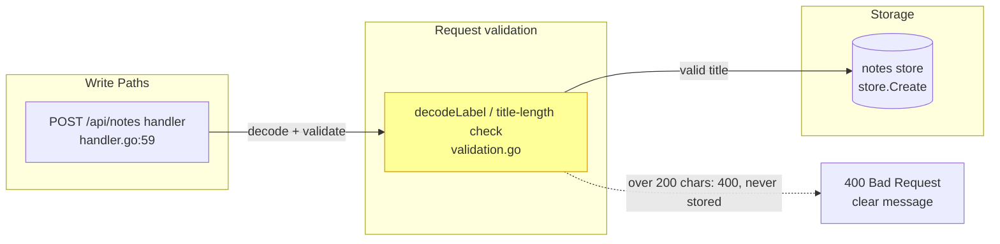
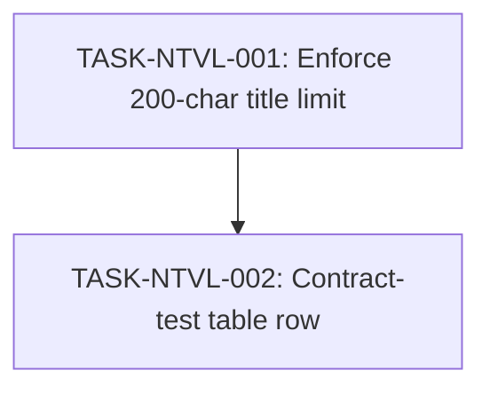

# Implementation Guide — FEAT-D267: Notes API Title Length Validation

Plan generated 2026-10-29T14:00:00Z for feature id FEAT-D267 (supplied verbatim).

## Already done and still to do

- "The notes API should refuse to create a note" — still to do — `apps/api/internal/notes/handler.go:59-72` the POST /api/notes handler answers 400 only when `decodeLabel` fails; a decode-clean title of any length reaches `store.Create` unchecked.
- "whose title is longer than 200 characters" — still to do — `apps/api/internal/notes/handler.go:59-72` no length limit exists on the create path; the handler tests reject a 1025-character body (`apps/api/internal/notes/handler_test.go:61-83`) only as invalid JSON, which proves a byte-level decode guard, not the requested 200-character rule.
- "answering 400 Bad Request" — still to do — `apps/api/internal/notes/handler.go:59-72` 400 is answered for decode failures only; the over-long-title request must gain its own 400 path with a clear message naming the title field and the 200-character limit.
- "Change only the Go API and its Go tests" — already done — `apps/api/internal/notes/handler_test.go:61` (and `apps/api/internal/notes/contract_test.go:57`) a Go test surface already exists for the create endpoint; the work extends these files in place rather than standing up anything new.

## Members of the plan (no named sets in the request)

The request names no set ("all the X" / "every X"); Block 15 does not apply. The route the plan changes, `POST /api/notes`, is declared at `apps/api/internal/notes/handler.go:59` and exercised at `apps/api/internal/notes/contract_test.go:71-74`.

## Tasks

| Task | Wave | Type | Mode | Complexity |
|------|------|------|------|------------|
| TASK-NTVL-001 Enforce the 200-character note title limit at note creation | 1 | feature | direct | 3 |
| TASK-NTVL-002 Extend the contract test table for the refused over-long title | 2 | testing | direct | 2 |

## Execution strategy

- Wave 1: TASK-NTVL-001 (handler + validation + handler tests).
- Wave 2: TASK-NTVL-002 (contract-table row; depends on the behaviour from wave 1).

## Data Flow: Read/Write Paths

New/changed node (yellow): the title-length rule inside the existing decode/validation path. The refused write is deliberately terminal — the request boundary is the persistence guard, matching scenario "A refused note-creation request persists nothing".

## Task Dependencies

## Scenario ownership

All six approved scenarios are owned by TASK-NTVL-001 (see `scenario_owners:` in the feature YAML). Every scenario asserts the HTTP-create surface that task delivers.

## Smoke gates — omitted

The descriptor's `test_roots` (`tests/e2e`, `tests/keycloak`) contain no Go paths, and the Go tests live under `apps/api/internal/notes/`, outside every declared root. Per the smoke-gate rule the `smoke_gates:` block is omitted entirely (ungated-waves omission reason: no positional pytest path under a declared test root could gate the Go work; nothing was invented). One-edit activation if ever wanted: add a test root covering `apps/api/...` to the descriptor and add a `smoke_gates:` block with `command: "go test ./apps/api/... -q"` and `after_wave: [1]`.

## Deferred Planning Decisions

| Decision point | Chosen default | Status |
|---|---|---|
| Review-scope clarification (Context A: focus, depth, trade-off priority) | Template defaults: all aspects, standard depth, balanced trade-offs | deferred |
| Decision checkpoint (accept/revise/implement) | implement (headless default) | deferred |
| Implementation-preferences prompt (Context B: approach, execution, testing depth) | Template defaults: recommended approach, auto-detected parallelism, default testing depth | deferred |
| Mode-boundary normalisation: TASK-NTVL-001 complexity 3 → `implementation_mode: direct` | direct (≤3) | deferred |
| Mode-boundary normalisation: TASK-NTVL-002 complexity 2 → `implementation_mode: direct` | direct (≤3) | deferred |
| ASSUM-001/002/003/004 (HTTP create endpoint; characters not bytes; create-only; plain message) | Spec assumption values carried into acceptance criteria as stated | deferred |
| Clear-message wording (name the title field and the 200-character limit) | Left to the coder; no structured envelope | deferred |