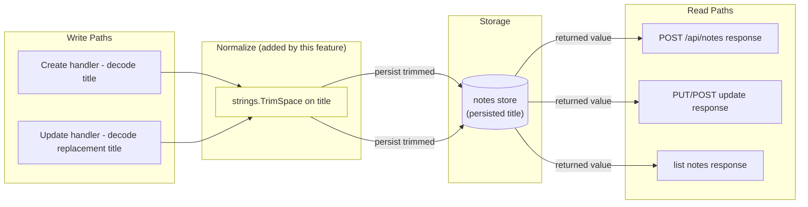
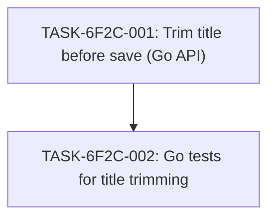

# Implementation Guide — Notes API Title Normalization (FEAT-6F2C)

This plan makes the Go notes API trim leading and trailing whitespace from a note's title before saving it, on both the create and update paths, so that the trimmed value is what is persisted and returned in the API response while the interior of the title is left unchanged. Change scope is limited to the Go API implementation and its Go tests.

## Already done and still to do

- "The notes API should trim leading and trailing spaces from a note's title before saving it" — still to do — `apps/api/internal/notes/handler.go:83` the Go notes API HTTP handlers and their in-process router exist, but no leading/trailing trim is applied to the note title on the create or update persistence path; `strings.TrimSpace` appears only in the Authorization-token check (`handler.go:87`, `handler.go:92`) and the request-body wrapper (`handler.go:116`), never to normalise the saved title.
- "Change only the Go API and its Go tests" — still to do — the change is scoped to `apps/api/internal/notes/`; no other area of the repository is touched.

The supplied search blocks were `status: partial` and `truncated: true`, so they are not the whole story of the repository. The persistence write path (`apps/api/internal/notes/store.go`) was not shown among the blocks, so the exact trim insertion point cannot be told from what was supplied; TASK-6F2C-001 is instructed to inspect the create/update write path and change only what is missing. The existing blank-title validation (`apps/api/internal/notes/validation.go`, referenced at `apps/api/internal/notes/handler_test.go:97-100`) already trims before checking for blankness — that rejection behaviour is out of scope and stays as-is.

## Data Flow: Read/Write Paths

The normalisation node (yellow) is the new step. Every read path that returns a note title now returns the persisted (trimmed) value. There are no disconnected read/write paths.

## Task Dependencies

TASK-6F2C-001 delivers the behaviour at the delivered surface (the API response) and owns every approved scenario. TASK-6F2C-002 runs after it and asserts that surface.

## §4: Integration Contracts

No cross-task data dependency carries a shared artifact (no env var, connection string, or generated schema passed between tasks) — TASK-6F2C-002 consumes TASK-6F2C-001's code directly through the package, not through an artifact. No Integration Contract is required.

## Wave Plan

- Wave 1: `TASK-6F2C-001` (Go API trim)
- Wave 2: `TASK-6F2C-002` (Go tests)

No smoke gate is emitted: the feature has no positional pytest path to gate on, and the plan targets Go tests under `apps/api/internal/notes/`. The descriptor's declared `test_roots` are `tests/e2e` and `tests/keycloak` (TypeScript e2e and shell keycloak), so none of the Go test paths in this plan falls under a declared pytest root. One-edit activation to add the block: introduce a Go smoke command whose positional paths are under a declared test root, or extend `test_roots` to include the Go test directory, then add a top-level `smoke_gates:` block keyed to wave 2.

## Deferred Planning Decisions

| Decision point | Chosen default | status |
|---|---|---|
| Review-scope clarification (focus / depth / trade-off priority) | Template defaults: all aspects, standard depth, balanced | deferred |
| Accept / revise / implement checkpoint | Implement (create feature structure) | deferred |
| Implementation preferences (approach / execution / testing depth) | Template defaults: recommended approach, auto-detect execution, testing by complexity | deferred |
| ASSUM-001 (trim applies to both create and update) — no human to confirm | Plan both create and update paths; both covered by TASK-6F2C-001 | deferred |
| ASSUM-002 (existing Go create/update persistence path exists) — no human to confirm | Plan against the existing Go handler/store; inspect write path in TASK-6F2C-001 | deferred |
| Persistence write path location (not shown in supplied blocks) — cannot be told from what was supplied | TASK-6F2C-001 inspects the write path and changes only what is missing | deferred |