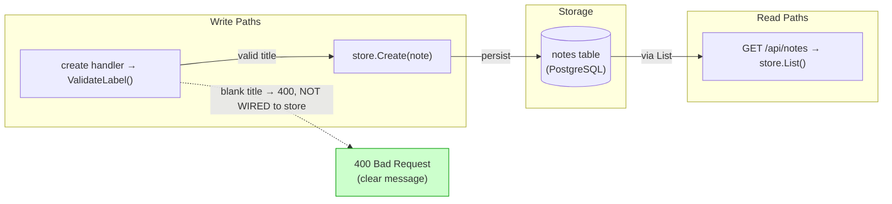
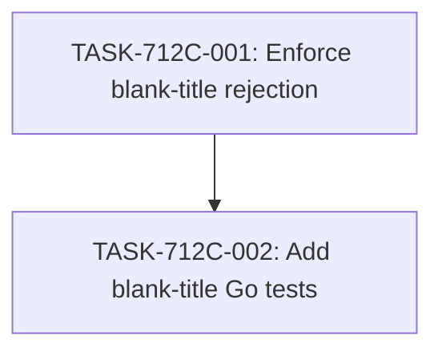

# Implementation Guide — Notes API Title Validation (FEAT-712C)

## Already done and still to do

- "refuse to create a note with an empty or blank title" — already done — `apps/api/internal/notes/validation.go:23` `ValidateLabel` trims surrounding whitespace and returns `errInvalidLabel` when the trimmed value is empty.
- "answering 400 Bad Request with a clear message" — still to do — `apps/api/internal/notes/validation.go:14` `errInvalidLabel` carries the message "invalid note label"; whether the create handler surfaces a message naming the title field on the 400 body is not shown by the supplied stretches, so the exact response body wording must be confirmed and adjusted only if it does not name the title.
- "Change only the Go API and its Go tests" — still to do — nothing found; the plan confines every change to `apps/api/internal/notes/` Go source and Go test files.

## Members of sets the request names

The request names no explicit set ("all the X" / "every X"); Block 15 does not apply.

## Deferred Planning Decisions

| Decision point | Chosen default | status |
|---|---|---|
| Review-scope clarification (focus / depth / trade-off) | Template default: all aspects, standard depth, balanced trade-off | deferred |
| Decision checkpoint (accept / revise / implement) | Always resolve to implement | deferred |
| Implementation-preferences prompt (approach / execution / testing depth) | Template default: recommended approach, auto-detect parallelism, default testing depth | deferred |
| Mode-boundary normalisation: TASK-712C-001 complexity 4 ⇒ task-work | task-work | deferred |
| Mode-boundary normalisation: TASK-712C-002 complexity 3 ⇒ direct | direct | deferred |
| Existing-code assumption: `ValidateLabel` already trims and rejects empty titles; the create handler's blank-title message wording is unverified | Confirm at build time and change only what is missing | deferred |

## Smoke gates

Omitted. The descriptor's `test_roots` (`tests/e2e`, `tests/keycloak`) contain no Go test root, and the feature's tests live under `apps/api/internal/notes/`. Per the smoke-gate rule, no `smoke_gates:` block is emitted because every positional pytest path would fall outside the declared roots. **One-edit activation:** if a Go test root is later declared in `test_roots`, add a `smoke_gates:` block with `after_wave: 1` and a `go test ./...` command under `apps/api/`.

## Operator follow-up tasks: 0

No task requires live infrastructure, a human in the loop, or wall-clock waiting.

## Data Flow: Read/Write Paths

The blank-title write path is intentionally disconnected from persistence: a refused request must reach no store call. The green node is the correct terminal for that path, not a defect.

## Task Dependencies

TASK-712C-002 asserts the behaviour TASK-712C-001 delivers, so it runs in a later wave.

## §4: Integration Contracts

No cross-task artifact contract is required: TASK-712C-002 consumes TASK-712C-001's handler behaviour through the in-process router, not through an environment variable, config file, or external artifact. The dependency is expressed in the task graph and the test's use of `Routes(store, ...)`.

## Scenario Ownership

All ten approved scenarios are owned by TASK-712C-001, the task that states the observable behaviour at the delivered surface (`POST /api/notes`). TASK-712C-002 tests that surface but does not deliver it, so it is not an owner.