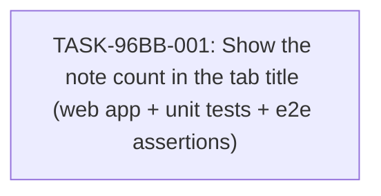

# Implementation Guide — Notes Count in Browser Tab Title (FEAT-96BB)

Show the number of notes in the browser tab title, for example "Notes (3)". Change only the web app and its tests.

## Already done and still to do

1. "the browser tab title shows the number of notes in the format \"Notes (N)\"" — still to do — nothing found — no `document.title` assignment or tab-title assertion appears in any supplied evidence stretch; the web app (`apps/web/src/App.tsx`) renders the note list and the "N notes" total but the ranked blocks show no title handling.
2. "the number of notes is available in the web app's state" — already done — `apps/web/src/App.test.tsx:438-448` the `totalAboveTheList` helper asserts a single total derived from the same collection that renders the notes list, proving the full count already lives in client-side state; `tests/e2e/specs/journey.spec.ts:46-75` shows the same collection populating both the list and the total at the browser surface.

The tab-title behaviour itself is still to do; only its data source already exists. TASK-96BB-001 therefore reuses the existing state (line 2) and builds the missing title (line 1), including the test assertions that prove it at both the unit and end-to-end surfaces.

## AC-Quality Warnings

No ambiguous or hard-to-verify acceptance criteria were found. Every criterion names a concrete surface (`document.title` or `page.title()`), a concrete expected string (`"Notes (N)"`), and a concrete trigger (load, add, delete, rapid add-then-delete). The "no backend, API, or storage change" criterion is verifiable by diff inspection against the scope guard. The "existing assertions still pass" criterion is verifiable by running the existing test suites unchanged.

## Data Flow: Read/Write Paths

```mermaid
flowchart LR
    subgraph Writes["Write Paths"]
        W1["App.tsx: add note"]
        W2["App.tsx: delete note"]
    end

    subgraph State["Client-side state"]
        S1[("notes collection\n(existing state)")]
    end

    subgraph Reads["Read Paths"]
        R1["note list render\n(existing)"]
        R2["\"N notes\" total above list\n(existing)"]
        R3["document.title = \"Notes (N)\"\n(NEW)"]
    end

    W1 -->|"mutates"| S1
    W2 -->|"mutates"| S1
    S1 -->|"renders"| R1
    S1 -->|"renders"| R2
    S1 -->|"useEffect keyed on notes"| R3

    style R3 fill:#ffc,stroke:#c90
```

All three read paths hang off the one existing notes collection, so the title can never diverge from the visible list. No write path is left without a reader. Caption: the yellow node is the only new read path; it is wired to the same state the list already reads.

## Task Dependencies



One task, one wave; no parallelism needed. Caption: the single task delivers the product change and extends both the unit tests and the e2e journey to assert the new surface.

## Scenario Ownership

All ten approved scenarios are owned by TASK-96BB-001, the task that states the tab-title behaviour at the delivered surface (`document.title` in the unit tests and `page.title()` in the e2e journey).

## Smoke Gates

Omitted. The descriptor's declared `test_roots` are `tests/e2e` and `tests/keycloak`; the web unit tests this feature changes live at `apps/web/src/App.test.tsx`, outside both roots, and no positional pytest path under a declared root would gate this feature's waves. Per the smoke-gate rule the `smoke_gates:` block is omitted entirely rather than pointed at an undeclared path.

**One-edit activation notice:** to arm the feature-level smoke gate, add a `smoke_gates:` block to `.guardkit/features/FEAT-96BB.yaml` whose command runs the e2e suite under the declared root, e.g. `command: "npm --prefix tests/e2e test"` with `after_wave: [1]`. The plan does not invent paths outside the declared roots.

## Deferred Planning Decisions

| Decision point | Chosen default | status |
|---|---|---|
| Review-scope clarification (Context A: focus / depth / trade-off priority) | template defaults — all aspects, standard depth, balanced trade-offs | deferred |
| Decision checkpoint (accept / revise / implement) | implement (headless always resolves to implement) | deferred |
| Implementation-preferences clarification (Context B: approach / execution / testing depth) | template defaults — recommended approach, auto-detect execution, default testing depth | deferred |
| Mode-boundary normalisation: TASK-96BB-001 complexity 4 ⇒ `implementation_mode: task-work` | task-work | deferred |
| ASSUM-001 (note count already in client-side state) — relied on by the plan's reuse of existing state | assumed true; the existing "N notes" total proves the count is client-side | deferred |
| ASSUM-002 (`document.title` is the surfacing mechanism) | assumed true per "browser tab title" / "web app" | deferred |
| ASSUM-003 (exact format "Notes (N)", including "Notes (0)") | assumed true per the request's example | deferred |

## Assumptions About Existing Code

- The web unit-test DOM shim in `apps/web/src/App.test.tsx` may lack a `document.title` property; TASK-96BB-001 extends the shim if needed (a test-only change inside the web app's own tests).
- The existing "N notes" total above the list is a separate surface and is left unchanged.