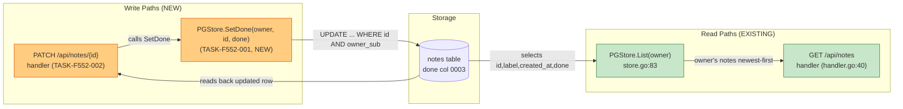
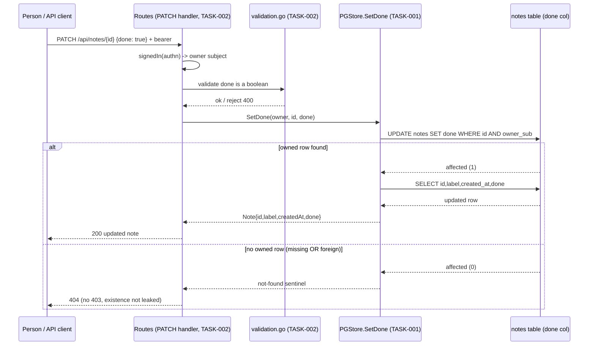
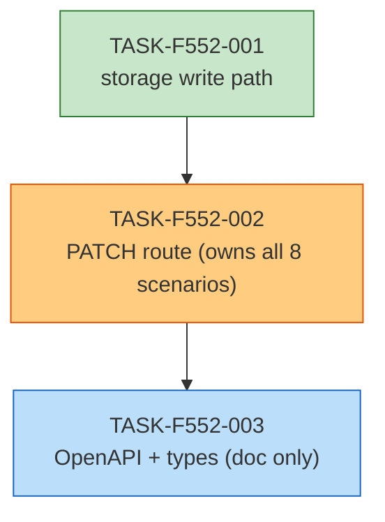

# Implementation Guide — Notes Done-Flag API (FEAT-F552)

## Already done and still to do

1. "Add PATCH /api/notes/{id} so the signed-in owner can set a note's done flag to true or false" — still to do — apps/api/internal/notes/handler.go:30 `Routes` registers only `GET /api/health`, `GET /api/notes` and (per the Store interface) `Create`; there is no `PATCH /api/notes/{id}` handler and `Store` (apps/api/internal/notes/handler.go:18) offers only `Create` and `List`, so nothing sets the flag from a route.
2. "the signed-in owner can set a note's done flag" — still to do — apps/api/internal/notes/store.go:83 `PGStore.List` reads the `done` column but there is no store method that writes it (`SetDone`/UPDATE is absent); the storage write behind the toggle is missing and TASK-F552-001 adds it.
3. "it returns the updated note" — still to do — apps/api/internal/notes/handler.go:30 the only JSON answers `Routes` writes today are the health envelope and the notes list; nothing returns a single updated note, because no PATCH handler exists.
4. "answers 404 for a note that does not exist" — still to do — apps/api/internal/notes/handler.go:38 (the `signedIn`-wrapped `GET /api/notes` region) the handler's error path answers 500/401 only; there is no not-found (404) handling, because the route that needs it is absent.
5. "answers 404 ... or belongs to someone else" — still to do — apps/api/internal/notes/handler.go:18 the `Store` interface is owner-scoped by contract but has no single-note lookup/update, so a foreign id has no code path to a 404 yet.
6. "the signed-in owner is required before any mutation (401)" — still to do — apps/api/internal/notes/handler.go:40 `GET /api/notes` already wraps its handler in `signedIn(authn, ...)` with a bearer authenticator; the new PATCH route must reuse that wrapper, so "required before mutation" is new for PATCH built on an existing mechanism.
7. "Set a note done or not done" — already done — apps/api/internal/notes/store.go:83 `PGStore.List` selects and scans the `done` column the 0003 migration adds (`NOT NULL DEFAULT false`); the stored flag and its false default exist and are read correctly, it is only not yet writable through the API.

## Members of "every note's done flag"

No "all the X / every X" phrase was named by the descriptor's `sets_the_request_names`, so no set-membership section is required. For completeness of the read side this feature builds on: the notes collection whose per-note `done` flag is already answered is produced by `apps/api/internal/notes/store.go:83` (`PGStore.List`) and rendered at `apps/api/internal/notes/handler.go:40` (`GET /api/notes`); the storage migration that defines the flag is `apps/api/migrations/0003_add_done.sql`. These are read-side facts already present, not new members.

## Deferred Planning Decisions

| Decision point | Chosen default | Status |
|---|---|---|
| Review-scope clarification (Context A: focus / depth / trade-off priority) | Template defaults (all aspects / standard depth / balanced trade-offs); interactive question auto-resolved, not asked | deferred |
| Accept/Revise/Implement decision checkpoint | Resolved to Implement (headless always implements); interactive prompt skipped | deferred |
| Implementation-preferences clarification (Context B: approach / execution parallel-vs-sequential / testing depth) | Template defaults (recommended approach / auto-detect execution / default testing depth); interactive question auto-resolved, not asked | deferred |
| ASSUM-001 unauthenticated PATCH status | Followed the spec/assumptions: `401 SignInRequired`, consistent with the existing `GET /api/notes`; the status is a spec assumption (`human_response: deferred`), carried as-is into TASK-F552-002 rather than re-decided here | deferred |
| ASSUM-002 updated-note response field set | Carried the assumption (id + done minimum, other fields preserved) as the acceptance criterion of TASK-F552-002; the human's confirmation of the full field set remains deferred | deferred |
| ASSUM-003 note id format | Carried the assumption (opaque string ids, consistent with the existing handler's string ids) into TASK-F552-001/002; not enforced as UUID/integer | deferred |
| `scenario_owners:` written here; `scenarios:` verifier stamp map NOT written | Ownership is the only field the planner writes; the verifier stamp map is decided downstream by rules not visible here | deferred |
| `smoke_gates` omitted | The descriptor's `test_roots` are `tests/e2e` and `tests/keycloak`; no in-scope (under a declared test root) pytest path exists for a smoke gate, so the `smoke_gates` block is omitted entirely (see note below) | deferred |

### Smoke gates — activation notice

The feature YAML carries **no `smoke_gates:` block**. The target repository's declared `test_roots` are `tests/e2e` and `tests/keycloak` (Playwright and shell — no pytest suite), so there is no positional pytest path under a declared root to gate on. Rather than invent a test path, the inter-wave gate is omitted. **One-edit activation:** if a pytest-based smoke suite is later added under a declared test root, add a single-object `smoke_gates:` block to `.guardkit/features/FEAT-F552.yaml` (e.g. `after_wave: 2`, `command: pytest tests/...` with every positional path under a declared `test_root`) to arm the R3 feature-level smoke oracle between waves.

## Data Flow: Read/Write Paths

New/changed paths are orange; pre-existing healthy paths are green.

**Disconnection Alert**: none. Every write path (`PATCH` handler → `SetDone` → `notes.done`) has a corresponding read path back to the person: the PATCH handler returns the freshly read-updated note directly, and the same column is read by `GET /api/notes` through `PGStore.List`. No read path lacks a caller.

## Integration Contracts

Watch the `alt` block: the "no owned row" branch collapses missing-id and foreign-id into the same `404`, and the note is only returned after the row is read back from `notes` — the "fetch then return" is complete (data flows to the client, no discard).

## Task Dependencies

No parallel wave here (the storage write feeds the route, which feeds the contract), so the graph is linear. Colour key: green = foundation, orange = the delivered surface, blue = contract/documentation.

## §4: Integration Contracts

### Contract: `SetDone` (storage write for the done flag)
- **Producer task:** TASK-F552-001
- **Consumer task(s):** TASK-F552-002
- **Artifact type:** `Store` interface method (Go), `SetDone(ctx context.Context, owner, id string, done bool) (Note, error)`
- **Format constraint:** the returned `Note` must carry `ID`, `Label`, `CreatedAt` (UTC) and the new `Done`, shaped the same way `PGStore.List` shapes a note (id rendered via `strconv.FormatInt`); a miss on the owner-scoped UPDATE returns a sentinel "not found" error, never a zero `Note`.
- **Validation method:** Coach verifies TASK-F552-002 calls `SetDone` (not `Create`/`List`) for the PATCH body, maps the sentinel to `404`, and serialises the returned note as the `200` response; the `go test` handler tests assert the owner/id/done the fake store received.

### Contract: `PATCH /api/notes/{id}` operation
- **Producer task:** TASK-F552-002 (the live route)
- **Consumer task(s):** TASK-F552-003
- **Artifact type:** OpenAPI operation + generated client type
- **Format constraint:** the `contract/openapi.yaml` `patch` operation and regenerated `apps/web/src/api-types.ts` must describe boolean `done` request body, `200` returning `Note`, and `404` (plus existing `401` `SignInRequired` / `500` `Unavailable`) — consistent with the sibling operations that already reference `NoteList`/`SignInRequired`/`Unavailable`.
- **Validation method:** Coach verifies `api-types.ts` is reproduced by `tools/contract/generate.mjs` with no diff and no existing path changed.

## Scenario → task mapping (verification at the delivered surface)

All 8 approved scenarios are owned by **TASK-F552-002**, the task that states the observable behaviour at the delivered surface (`PATCH /api/notes/{id}`), per the routing law: each is an HTTP endpoint scenario (`hurl`). TASK-F552-001 provides the storage write and is **not** the owner of any scenario; TASK-F552-003 documents the contract and owns none. The `scenarios:` verifier stamp map is not written here (decided downstream); ownership lives in the feature YAML's `scenario_owners:` map.

## Execution Strategy

- **Wave 1:** TASK-F552-001 (storage write path) — `go test ./...` from `apps/api/`
- **Wave 2:** TASK-F552-002 (PATCH route) — `go test ./...` from `apps/api/`
- **Wave 3:** TASK-F552-003 (OpenAPI + types) — `npm run contract` + `npm run lint`

Start with Wave 1; each wave depends on the previous one, so run them in order.