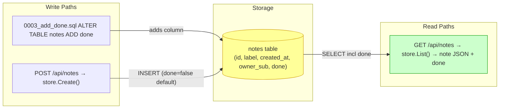
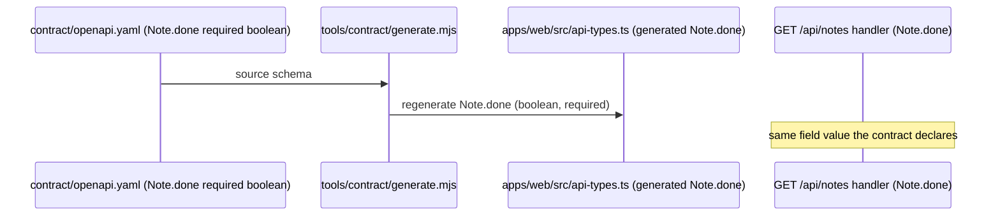
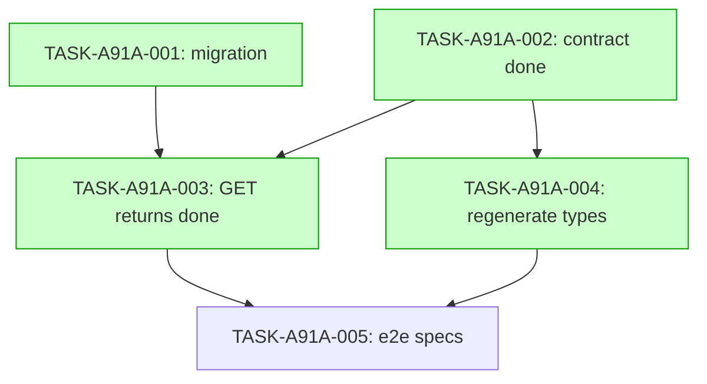

# Implementation Guide — Notes Done Flag (FEAT-A91A)

Add a done flag to notes: a new migration adds a done column that is false by default, and `GET /api/notes` returns each note's done flag, with the contract and the generated web types updated to match.

## Already done and still to do

1. "a new migration adds a done column" — still to do — apps/api/migrations/0002_add_created_at.sql:3 the migrations tree has `0001_create_notes.sql` and `0002_add_created_at.sql` but no `done` column anywhere; a new `0003` migration is missing
2. "GET /api/notes returns each note's done flag" — still to do — apps/api/internal/notes/handler.go:46 the `GET /api/notes` route exists and returns `NoteList`, but the delivered note carries only `id`, `label`, `createdAt` (`apps/api/internal/notes/handler_test.go:198`); no `done` field is serialized
3. "a done column that is false by default" — still to do — apps/api/migrations/0002_add_created_at.sql:3 the `NOT NULL DEFAULT` pattern already exists for `created_at`; the `done BOOLEAN NOT NULL DEFAULT false` column and its backfill are missing
4. "with the contract ... updated to match" — still to do — contract/openapi.yaml:32 the contract declares `NoteList`/`Note` for `GET /api/notes`, but no `done` boolean property on the `Note` schema
5. "and the generated web types updated to match" — still to do — apps/web/src/api-types.ts:125 the generated `NoteList` maps to `components["schemas"]["Note"]` but the generated `Note` type has no `done` field
6. "The generated web note type includes the done flag" — still to do — apps/web/src/api-types.ts:119 the generated note response type is present but lacks the `done` boolean; regeneration from the updated contract is needed
7. "The done field reaches the web type only through regeneration" — still to do — apps/web/src/api-types.ts:125 `api-types.ts` is generated from the contract (`README.md:34`, `contract/openapi.yaml:1`); the done field must arrive via regeneration, not hand-editing

## Members of "each note"

- notes-api / Notes fixture — the set the request's "each note" ranges over: one note is one `Note` row in the `notes` table returned per entry of `GET /api/notes`'s `NoteList` — contract/openapi.yaml:32
- README (path `apps/api/migrations`, `0001`/`0002` and the `notes` table) — member (source of the set) — README.md:33
- README (path `tests/e2e`, the journey that lists and reloads notes) — member (read path over the set) — README.md:44
- apps/web/src/App.test.tsx (the `NewNote` view type and the only view that adds a note) — member (write path into the set) — apps/web/src/App.test.tsx:395
- apps/web/src/App.test.tsx (`import type { Note } from "./api"`) — member (client note shape) — apps/web/src/App.test.tsx:3
- contract/openapi.yaml (source of the notes API contract; `api-types.ts` is generated from it) — member — contract/openapi.yaml:1
- contract/openapi.yaml (contract title `Notes fixture API`) — member — contract/openapi.yaml:7
- apps/api/internal/notes/contract_test.go (validates `/api/notes` GET/POST against the contract) — member — apps/api/internal/notes/contract_test.go:70
- apps/api/internal/notes/contract_test.go (`listNotes` create/list response cases) — member — apps/api/internal/notes/contract_test.go:78
- apps/web/src/api-types.ts (generated `/api/notes` → `listNotes` op) — member (generated type over the set) — apps/web/src/api-types.ts:21
- apps/web/src/api-types.ts (`get: operations["listNotes"]`) — member — apps/web/src/api-types.ts:28
- apps/api/cmd/api/main.go (imports the `internal/notes` package) — member (source) — apps/api/cmd/api/main.go:16
- apps/api/cmd/api/main.go (the notes API's run identity) — member (runtime) — apps/api/cmd/api/main.go:90
- apps/web/src/api.ts (the `NewNote` type and the note fetch/unavailable handling) — member (client write/read of the set) — apps/web/src/api.ts:6
- apps/web/src/api.ts (the notes service read path) — member — apps/web/src/api.ts:60
- apps/api/internal/notes/handler_test.go (the only documented note write, `GET`/`POST /api/notes`) — member (write test) — apps/api/internal/notes/handler_test.go:299
- apps/api/internal/notes/handler_test.go (`POST /api/notes` create wire shape) — member (write test) — apps/api/internal/notes/handler_test.go:191
- apps/api/internal/notes/store.go (`List returns owner's newest notes first` — the read query over the set) — member (data access) — apps/api/internal/notes/store.go:64
- apps/api/internal/notes/store.go (the `notes` package) — member (data access) — apps/api/internal/notes/store.go:1
- apps/api/migrations/0002_add_created_at.sql (`ALTER TABLE notes ...`, the per-row column pattern the new `done` column follows) — member (per-row schema) — apps/api/migrations/0002_add_created_at.sql:3
- apps/api/migrations/0002_add_created_at.sql (the `notes_owner_created_idx` per-row index) — member — apps/api/migrations/0002_add_created_at.sql:4
- apps/api/internal/notes/handler.go (`GET /api/notes` routes the read path) — member (delivered read surface) — apps/api/internal/notes/handler.go:46
- apps/api/internal/notes/handler.go (`internal/notes` package) — member (delivered surface) — apps/api/internal/notes/handler.go:36
- tests/e2e/specs/journey.spec.ts (creates a note via the `New note` field) — member (read path over the set) — tests/e2e/specs/journey.spec.ts:140
- tests/e2e/specs/journey.spec.ts (fetches `/api/notes` anonymously) — member (read path over the set) — tests/e2e/specs/journey.spec.ts:186
- Not members: scripts/check.sh:25, scripts/check-feature.sh:140, scripts/check-feature.sh:152, scripts/migrate.sh:16, scripts/migrate.sh:28, scripts/stack-lib.sh:23, scripts/stack-lib.sh:71 — build/CI and migration-runner plumbing (the `notes` DB name and schema_migrations counts), not the set of notes
- Not members: tests/keycloak/test_configure_realm_readiness.sh:200, tests/keycloak/test_configure_realm_readiness.sh:278, scripts/keycloak/configure-realm.inside.sh:40, scripts/keycloak/configure-realm.inside.sh:54 — Keycloak realm/client/mapper config (the `notes-api` audience and `notes-web` client names), not notes
- Not members: apps/web/src/App.test.tsx:3 (import line — covered above), package-lock.json:3568, package-lock.json:4586 — generated dependency lock (`notes-contract-tools`), not a source of the set
- Not members: qa/live-gate-driver.mjs:111, qa/live-gate-driver.mjs:11, tests/e2e/global-setup.ts:58, tests/e2e/global-setup.ts:63, tests/e2e/playwright.config.ts:5, tests/e2e/playwright.config.ts:7 — live-gate and e2e harness env plumbing (`NOTES_BASE_URL`/`NOTES_RUN_ID`), not notes
- Not members: compose.yaml:90, compose.yaml:104, deploy/deploy.sh:80, deploy/deploy.sh:112 — container/image naming (`notes-api`, `react-go-notes` identity labels), not notes

## §4: Integration Contracts

### Contract: done (column → response)
- **Producer task:** TASK-A91A-001 (add `notes.done` column)
- **Consumer task(s):** TASK-A91A-003 (return `done` from `GET /api/notes`)
- **Artifact type:** database column on the `notes` table
- **Format constraint:** `done` is `BOOLEAN NOT NULL DEFAULT false` on every `notes` row (existing rows backfilled to false), so the store's `SELECT` yields a non-null boolean and the handler serializes it as JSON key `done` without a null branch.
- **Validation method:** Coach verifies `apps/api/migrations/0003_add_done.sql` declares `done BOOLEAN NOT NULL DEFAULT false`, and that `GET /api/notes` returns a boolean `done` per note (the new `done_test.go`).

### Contract: contract (Note.done → generated web type)
- **Producer task:** TASK-A91A-002 (declare `Note.done` in `contract/openapi.yaml`)
- **Consumer task(s):** TASK-A91A-004 (regenerate `apps/web/src/api-types.ts`)
- **Artifact type:** OpenAPI component schema property
- **Format constraint:** `Note.done` is `type: boolean` and is listed in `Note.required`, so `openapi-typescript` (`tools/contract/generate.mjs`) emits a non-optional `done: boolean` on `components["schemas"]["Note"]` in `apps/web/src/api-types.ts`.
- **Validation method:** Coach verifies `contract/openapi.yaml` `Note.required` includes `done`, and `npm run contract:check` passes (committed `api-types.ts` matches regenerated output with the `done` field).

## Diagrams

### Data Flow: Read/Write Paths (the delivered surface)



The done column is written by the migration (default false) and by Create (default false), read back verbatim by `GET /api/notes`. All write paths have a corresponding read path — no disconnection.

### Integration Contract Diagram (contract → generated type)



The generated `Note.done` flows only from the contract via regeneration (never hand-edited), and matches the `done` the read endpoint returns.

### Task Dependencies



Wave 1 (T1, T2) and Wave 2 (T3, T4) each hold parallel-safe tasks; Wave 3 (T5) builds on the finished surface.

## Waves & Execution Strategy

- **Wave 1 (parallel):** `TASK-A91A-001` (migration), `TASK-A91A-002` (contract). Independent declarations; safe to run in parallel.
- **Wave 2 (parallel):** `TASK-A91A-003` (return done from GET), `TASK-A91A-004` (regenerate web types). Both depend only on Wave 1.
- **Wave 3:** `TASK-A91A-005` (e2e journey/smoke specs). Builds on the delivered read path and generated type.

Recommended parallelism: 2.

## Deferred Planning Decisions

| Decision point | Chosen default | status |
|---|---|---|
| Context A — Review scope clarification (review focus, analysis depth, trade-off priority) | Template default: all aspects / standard depth / balanced trade-offs | deferred |
| Decision checkpoint (Accept / Revise / Implement) | Auto-resolved to **Implement** (always, per headless contract) | deferred |
| Context B — Implementation preferences (approach, execution parallelism, testing depth) | Template default: recommended approach / auto-detect parallelism / default testing depth by complexity | deferred |
| ASSUM-001 — Backfill of pre-existing rows to `done=false` | Adopted as planned (migration `NOT NULL DEFAULT false` backfills existing rows) | deferred |
| ASSUM-002 — `done` is a simple boolean, not a status enum | Adopted as planned (`BOOLEAN` column, contract, and generated type) | deferred |
| ASSUM-003 — Slice is read-path only (no create/update/toggle endpoint) | Adopted as planned (read-only GET; `NewNote` request schema unchanged) | deferred |
| ASSUM-004 — `done` is a required (non-optional) boolean on the contract | Adopted as planned (`done` added to `Note.required`) | deferred |
| ASSUM-005 — Web types are regenerated from the contract (not hand-edited) | Adopted as planned (`npm run contract:generate`) | deferred |

## Operator follow-up tasks: 0 (omitted)

No task in this plan is `operator_handoff`; the count line is omitted. All acceptance criteria are `present_in_codebase`-style and satisfiable by the Player ↔ Coach loop (unit/contract/e2e tests against the disposable stack), so there is no manual follow-up checklist.

## Smoke gates (omitted — ungated-waves note)

No `smoke_gates:` block is emitted. The descriptor's declared `test_roots` are `tests/e2e` and `tests/keycloak`, and the repository's smoke gate is the aggregate `bash scripts/check.sh` (per `README.md:40`), which does not use positional pytest paths under those roots. Rather than invent a test path outside the declared roots (forbidden), the block is omitted entirely.

**One-edit activation notice:** to activate feature-level smoke gating, add a top-level block to `.guardkit/features/FEAT-A91A.yaml`, verifying each path against the target repo's real tree first:

```yaml
smoke_gates:
  after_wave: [2]
  command: |
    set -e
    bash scripts/check.sh
  expected_exit: 0
  timeout: 120
```

`after_wave: [2]` is safe because the tests exercised by the check exist by the end of Wave 2 (the delivered read path and regenerated types land in Wave 2).

## Routing-law note (not written — repo/human policy)

Per `/feature-spec`'s proposed verifier routing, the scenario homes are: `hurl` for the HTTP-response scenarios ("A newly created note is not done by default", "GET /api/notes returns each note's stored done flag", "A completed note is not omitted from the notes list", "The done flag carries exactly the two boolean states", "Every note in the response carries a done field", "The done flag does not displace the existing note fields", "The notes read endpoint does not accept a done value from the caller"), and `toolchain` for "A note that existed before the migration is not done", "The contract declares the done flag on the note object", "The generated web note type includes the done flag", and "The done field reaches the web type only through regeneration" (each `toolchain` stamp requires a `test_ref:` naming a test node). The `scenarios:` stamp map and `routing_law:` are decided downstream (verifier rules / repo `.guardkit/config.yaml`); the plan-writer does not emit them.