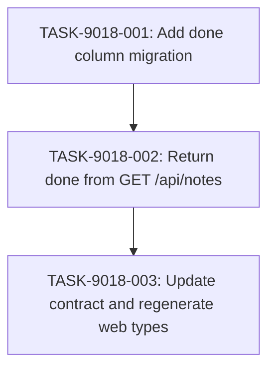

# Implementation Guide — Notes Done Flag (FEAT-9018)

**Feature**: Notes Done Flag
**Feature id**: FEAT-9018 (supplied verbatim)
**Specification**: `features/notes-done-flag/notes-done-flag.feature` (committed on the target branch)
**Generated**: 2026-07-09T14:32:00Z
**Aggregate complexity**: 5/10
**Tasks**: 3 · **Waves**: 3 (sequential)

## Already done and still to do

1. "a new migration adds a done column that is false by default" — still to do — `apps/api/migrations/0002_add_created_at.sql:3` The migrations tree holds only `0001_create_notes.sql` and `0002_add_created_at.sql`; `0002` shows the `ALTER TABLE notes ADD COLUMN … NOT NULL DEFAULT …;` pattern to follow, but no `done` column exists.
2. "GET /api/notes returns each note's done flag" — still to do — `apps/api/internal/notes/handler.go:46` `GET /api/notes` is already routed and calls `store.List`, but the note shape it returns carries no `done` field.
3. "with the contract and the generated web types updated to match" — still to do — `contract/openapi.yaml:1` The contract is the source the web types are generated from, but it does not declare `done`; `apps/web/src/api-types.ts` is generated from it and likewise lacks the field.

## Members of "each note"

The request's phrase "each note" names the set of note objects returned by `GET /api/notes`. The descriptor listed 24 candidate files (of 48 matches; `listed_all` is false, so 24 matching files were not listed).

- `apps/api/internal/notes/handler.go` — `apps/api/internal/notes/handler.go:46` — the `GET /api/notes` handler that returns the note list.
- `apps/api/internal/notes/store.go` — `apps/api/internal/notes/store.go:64` — `List` returns the owner's notes; the `Note` shape lives here.
- `contract/openapi.yaml` — `contract/openapi.yaml:1` — the source of the notes API contract the web types are generated from.
- `apps/web/src/api-types.ts` — `apps/web/src/api-types.ts:21` — the generated `Note`/`/api/notes` types.
- `apps/web/src/api.ts` — `apps/web/src/api.ts:6` — the web client that consumes the generated `Note` type.
- `apps/web/src/App.tsx` — `apps/web/src/App.tsx:12` — the view that renders the notes list.
- `apps/api/internal/notes/handler_test.go` — `apps/api/internal/notes/handler_test.go:188` — pins the note wire shape at the surface.
- `apps/api/internal/notes/contract_test.go` — `apps/api/internal/notes/contract_test.go:92` — the contract validator that bites on note responses.
- `apps/api/cmd/api/main.go` — `apps/api/cmd/api/main.go:16` — wires the notes package into the server.
- `apps/api/migrations/0002_add_created_at.sql` — `apps/api/migrations/0002_add_created_at.sql:3` — the `ALTER TABLE notes ADD COLUMN … DEFAULT …` pattern the new migration follows.
- `scripts/migrate.sh` — `scripts/migrate.sh:16` — applies the migrations against the `notes` database.
- `scripts/check-feature.sh` — `scripts/check-feature.sh:140` — the connected check that applies migrations and asserts `schema_migrations`.
- `README.md` — `README.md:33` — documents the migrations tree and the notes endpoints.
- `tests/e2e/specs/journey.spec.ts` — `tests/e2e/specs/journey.spec.ts:140` — the browser journey that creates and lists notes.
- Not members: `apps/web/src/App.test.tsx`, `apps/web/src/api.test.ts` — tests of what is already there; `tests/keycloak/test_configure_realm_readiness.sh`, `scripts/keycloak/configure-realm.inside.sh`, `scripts/stack-lib.sh`, `compose.yaml`, `deploy/deploy.sh`, `qa/live-gate-driver.mjs`, `tests/e2e/global-setup.ts`, `tests/e2e/playwright.config.ts`, `scripts/check.sh`, `package-lock.json` — infrastructure, deployment, and tooling that merely mention "note" in a name or env var, not the note object itself.

## Deferred Planning Decisions

| Decision point | Chosen default | status |
|---|---|---|
| Review-scope clarification (focus / depth / trade-off priority) | template defaults: focus=all, depth=standard, trade-off=balanced | deferred |
| Decision checkpoint (accept / revise / implement) | always resolve to implement | deferred |
| Implementation-preferences prompt (approach / execution / testing depth) | template defaults: recommended approach, auto-detect parallel, testing=default | deferred |
| Mode-boundary normalisation | `implementation_mode` set to `task-work` for complexity ≥ 4 (TASK-9018-002) and `direct` for ≤ 3 (TASK-9018-001, TASK-9018-003) | deferred |

## Smoke gates

Omitted. The descriptor's `test_roots` (`tests/e2e`, `tests/keycloak`) are Playwright and shell suites, not pytest roots, and the feature's verification is Go tests plus the connected check — there is no positional pytest path under a declared test root to gate on. **Ungated-waves omission reason**: no pytest-based smoke command exists under the declared roots, so a `smoke_gates:` block would reference paths outside them. **One-edit activation notice**: to activate the R3 feature-level smoke gate, add a `smoke_gates:` block whose `command` invokes the project's own connected check (e.g. `bash scripts/check.sh`) with `after_wave` set to the wave whose completion should be gated.

## Operator follow-up tasks: 0

No task in this plan requires live infrastructure, a human in the loop, or wall-clock waiting; all acceptance criteria are provable by the repository's own Go tests and the connected check.

## Data Flow: Read/Write Paths

```mermaid
flowchart LR
    subgraph Writes["Write Paths"]
        W1["migration 0003\nALTER TABLE notes ADD COLUMN done"]
        W2["PGStore.Create\n(inserts without done; column default)"]
    end

    subgraph Storage["Storage"]
        S1[("notes table\n(done BOOLEAN NOT NULL DEFAULT false)")]
    end

    subgraph Reads["Read Paths"]
        R1["PGStore.List\n(selects done)")
        R2["GET /api/notes handler\n(returns done on each note)")
        R3["contract/openapi.yaml\n(done required boolean)")
        R4["apps/web/src/api-types.ts\n(generated Note.done)")
    end

    W1 -->|"adds column"| S1
    W2 -->|"row default false"| S1
    S1 -->|"via List"| R1
    R1 -->|"note shape"| R2
    R2 -->|"shape described by"| R3
    R3 -->|"npm run contract:generate"| R4

    style R4 fill:#cfc,stroke:#090
```

**Disconnection Alert**: none. Every write path (the migration, the create default) has a corresponding read path (the list handler, the contract, the generated types). The generated web type is the terminal read surface; the request does not ask the view to render `done`, so no further read path is required.

## Integration Contracts

### Contract: done column
- **Producer task:** TASK-9018-001 (migration `0003_add_done.sql`)
- **Consumer task(s):** TASK-9018-002 (`PGStore.List` selects `done`)
- **Artifact type:** database column
- **Format constraint:** `done BOOLEAN NOT NULL DEFAULT false` on the `notes` table, so `List` can select a non-null boolean and pre-migration rows read back as `false`.
- **Validation method:** Coach verifies `apps/api/migrations/0003_add_done.sql` adds the column with `NOT NULL DEFAULT false`, and that `store.go`'s `List` query selects `done`.

### Contract: done field on the note response
- **Producer task:** TASK-9018-002 (handler returns `done` on each note)
- **Consumer task(s):** TASK-9018-003 (contract declares `done` required; contract_test validator loads it)
- **Artifact type:** JSON response field
- **Format constraint:** every note object in the `GET /api/notes` response carries `done` as a JSON boolean, never omitted when `false`.
- **Validation method:** Coach verifies `contract/openapi.yaml` lists `done` in the note schema's `required` list and that `TestContractRefusesForbiddenResponses` refuses a list response missing `done`.

## Task Dependencies



_The three tasks form a strict chain: the migration lands the column, the read surface reads it, the contract and generated types describe it. No parallelism is available._

## Scenario Ownership

| Scenario (verbatim) | Owner task |
|---|---|
| The notes list reports done false for all notes after the migration | TASK-9018-002 |
| The notes list reports the done flag for every note | TASK-9018-002 |
| A note that has never been marked complete is returned with done false | TASK-9018-002 |
| Existing note fields and the endpoint path are unchanged | TASK-9018-002 |
| A client built from the contract treats done as always present | TASK-9018-003 |
| A note marked complete is returned with done true | TASK-9018-002 |
| The notes list never returns a non-boolean done value | TASK-9018-002 |
| The notes list returns note fields the existing client consumes | TASK-9018-002 |

The read surface (`GET /api/notes`) is owned by TASK-9018-002; the contract/generated-type surface is owned by TASK-9018-003. No owner is a testing, documentation, or operator_handoff task.

## Notes on existing checks (Block 17)

- `apps/api/internal/notes/contract_test.go` already pins the note wire shape (e.g. `TestContractRefusesForbiddenResponses` refuses a response missing `createdAt`). The request does not ask to change that behaviour, so it is kept; the only contract-test change is to make the validator bite on a missing `done` once the contract declares it required (planned in TASK-9018-002/003).
- `tests/e2e/specs/journey.spec.ts` and `apps/web/src/App.test.tsx` pin the existing notes journey and view. The request does not ask the view to render `done`, so these are kept unchanged; the added field is additive and the existing client tolerates it (ASSUM-005).