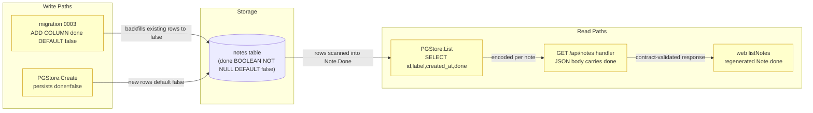
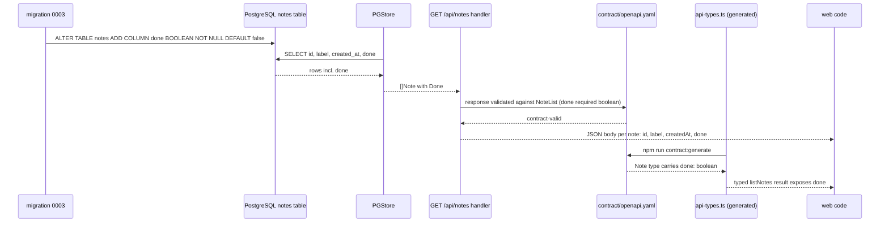
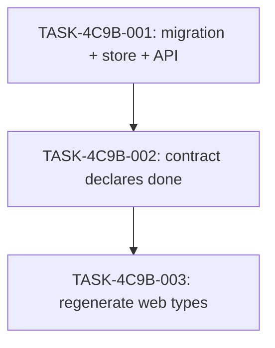

# Implementation Guide — Notes Done Flag (FEAT-4C9B)

**Feature**: Add a done flag to notes: a new migration adds a done column that is false by default, and GET /api/notes returns each note's done flag, with the contract and the generated web types updated to match.
**Stack**: generic (undeclared in the request; repository evidence indicates a Go `net/http` API, an OpenAPI contract, and TypeScript web types generated via `npm run contract:generate`).
**Created**: 2026-10-18T09:00:00Z
**Tasks**: 3 · **Waves**: 3 · **Aggregate complexity**: 5

## Already done and still to do

1. "a new migration adds a done column that is false by default" — still to do — apps/api/migrations/0002_add_created_at.sql:3 The migrations directory holds only `0001_create_notes.sql` and `0002_add_created_at.sql`; `0002` shows the `ALTER TABLE notes ADD COLUMN ... NOT NULL DEFAULT ...` pattern to follow, but no `done` column exists.
2. "GET /api/notes returns each note's done flag" — still to do — apps/api/internal/notes/handler.go:46 The route is served by `signedIn(...)` calling `store.List`, but the underlying `List` query (`apps/api/internal/notes/store.go:69`) selects only `id, label, created_at`; no `done` field is returned.
3. "the contract ... updated to match" — still to do — contract/openapi.yaml:32 The `GET /api/notes` 200 response references `#/components/schemas/NoteList`; the note item schema declares no `done` property, and the contract test's forbidden-response table (`apps/api/internal/notes/contract_test.go:105`) refuses a note missing `createdAt` but has no `done` case.
4. "the generated web types updated to match" — still to do — apps/web/src/api-types.ts:119 The generated types declare the `GET /api/notes` 200 response as `NoteList` with no `done` property on the note item; regeneration from the updated contract is required.
5. "the persistence mapping exposes done as a boolean field available to the application layer" — still to do — apps/api/internal/notes/store.go:64 The `Note` struct and `List`/`Create` mapping carry `ID`, `Label`, `CreatedAt` only; no `Done` field exists.

## Members of "each note"

The request's "each note" set is the notes listing surface and everything that shapes a listed note. Every listed candidate appears below; members are the files that shape or serve the per-note listing, non-members are tests of what is already there, fixtures, and infrastructure that merely mentions notes.

- The notes API route that serves each note — `apps/api/internal/notes/handler.go:46`
- The persistence mapping that reads each note's fields — `apps/api/internal/notes/store.go:64`
- The migration that adds the per-note column — `apps/api/migrations/0002_add_created_at.sql:3` (pattern for the new `0003`)
- The contract that declares each note's fields — `contract/openapi.yaml:7`
- The generated web types that type each note — `apps/web/src/api-types.ts:21`
- The web fetch layer that reads each listed note — `apps/web/src/api.ts:6`
- The migration runner that applies the per-note column — `scripts/migrate.sh:16`
- The connected check that exercises the listing end to end — `scripts/check-feature.sh:140`
- The aggregate check that runs the suites — `scripts/check.sh:25`
- The stack settings that name the notes service — `scripts/stack-lib.sh:23`
- The stack definition that runs the notes API — `compose.yaml:90`
- The deployment script that ships the notes API — `deploy/deploy.sh:80`
- The README that documents the notes surface — `README.md:33`
- Not members: `apps/web/src/App.test.tsx`, `apps/api/internal/notes/contract_test.go`, `apps/api/internal/notes/handler_test.go`, `tests/e2e/specs/journey.spec.ts`, `apps/api/cmd/api/main.go`, `tests/keycloak/test_configure_realm_readiness.sh`, `package-lock.json`, `scripts/keycloak/configure-realm.inside.sh`, `qa/live-gate-driver.mjs`, `tests/e2e/global-setup.ts`, `tests/e2e/playwright.config.ts` — tests of what is already there, entrypoints, fixtures, and infrastructure that mention notes without shaping the per-note listing.

## Deferred Planning Decisions

| Decision point | Chosen default | Status |
|---|---|---|
| Review-scope clarification (Context A: focus, depth, trade-off priority) | Template defaults — all aspects, standard depth, balanced trade-offs | deferred |
| Decision checkpoint (accept / revise / implement) | Always resolve to implement (headless mode) | deferred |
| Implementation-preferences prompt (Context B: approach, execution, testing depth) | Template defaults — recommended approach, auto-detect execution, default testing depth | deferred |

## Assumptions carried from the specification

- ASSUM-001 — the contract is a machine-readable OpenAPI schema declaring `done` as a required boolean property (TASK-4C9B-002).
- ASSUM-002 — web types are regenerated from the contract by the existing codegen step and committed, not hand-edited (TASK-4C9B-003).
- ASSUM-003 — the slice is read-only; setting `done` to true is out of scope, so done-state is seeded as stored state in tests (TASK-4C9B-001).
- ASSUM-004 — pre-migration notes are observable only through the listing; column-default behaviour is pinned via the listing rather than a storage probe (TASK-4C9B-001).

## Data Flow: Read/Write Paths

_New/changed paths in yellow. Every write path has a corresponding read path — no disconnection alert._

## Integration Contracts

## Task Dependencies

_Waves are strictly sequential (3 waves, one task each): the contract must match the delivered response before regeneration._

## §4: Integration Contracts

### Contract: done column (migration → store)
- **Producer task:** TASK-4C9B-001
- **Consumer task(s):** TASK-4C9B-001 (same task — the migration and the store mapping land together)
- **Artifact type:** database column
- **Format constraint:** `done BOOLEAN NOT NULL DEFAULT false` on `notes`, following the `0002_add_created_at.sql` pattern
- **Validation method:** `scripts/check-feature.sh` upgrade-from-0001 / fresh-install / idempotent-runs pass; the listing returns `done: false` for pre-existing rows

### Contract: done field (API response → contract)
- **Producer task:** TASK-4C9B-001
- **Consumer task(s):** TASK-4C9B-002
- **Artifact type:** JSON response field of `GET /api/notes`
- **Format constraint:** every note object carries `"done": true|false` (never omitted, never null), alongside `id`, `label`, `createdAt`
- **Validation method:** `contractRouter` in `apps/api/internal/notes/contract_test.go` validates the live-shaped response against `contract/openapi.yaml`; the forbidden-response table refuses missing/null `done`

### Contract: contract → generated web types
- **Producer task:** TASK-4C9B-002
- **Consumer task(s):** TASK-4C9B-003
- **Artifact type:** `contract/openapi.yaml` note item schema
- **Format constraint:** `done` is a required boolean property of the note schema; regeneration via `npm run contract:generate` must produce a `Note` type with `done: boolean`
- **Validation method:** `npm run contract:check` passes (no drift); `npm run typecheck` passes against existing web consumers

## Smoke Gates — omission notice

The `smoke_gates:` block is **omitted**. The descriptor's declared `test_roots` are `tests/e2e` and `tests/keycloak`; the repository's fast native checks live in `scripts/check.sh` (gofmt, vet, race tests, contract tests, tsc, ESLint, Prettier) and the connected browser journey in `scripts/check-feature.sh` — neither is a positional pytest path under a declared test root, and no pytest suite exists in this repository. Per the smoke-gate rule, a gate would require a path outside the declared roots, so the block is omitted rather than invented.

**One-edit activation notice**: to arm the feature-level smoke oracle, add a `smoke_gates:` block to `.guardkit/features/FEAT-4C9B.yaml` whose `command` invokes an existing check script (e.g. `bash scripts/check.sh`) with `after_wave` set to the wave after the last building task (wave 3). Paths inside the command must be verified against the target repository before authoring.

## Execution Strategy

- **Wave 1** — TASK-4C9B-001 (task-work, complexity 5): migration + store + API response.
- **Wave 2** — TASK-4C9B-002 (direct, complexity 3): contract declares the required boolean `done`.
- **Wave 3** — TASK-4C9B-003 (direct, complexity 3): regenerate `api-types.ts` via `npm run contract:generate`.

## Verification

- `go test ./... -race` in `apps/api` (unit + contract tests).
- `npm run contract:check`, `npm run typecheck`, web unit tests.
- `bash scripts/check.sh` (aggregate native check).
- `bash scripts/check-feature.sh` (connected browser journey — the declared `feature_check`).