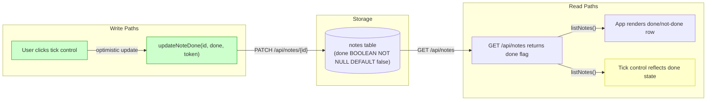
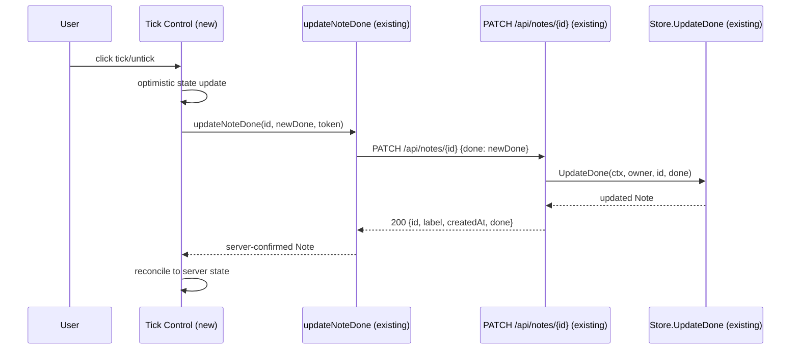
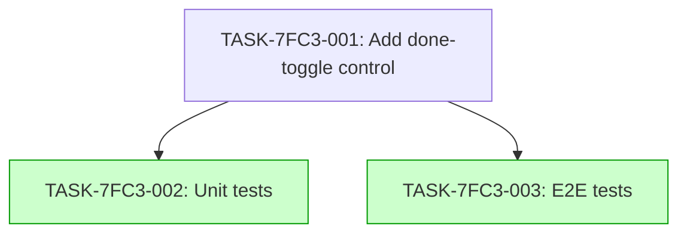

# Implementation Guide: Notes Done-Toggle (Web App)

**Feature**: FEAT-7FC3
**Generated**: 2026-07-09T14:32:00Z
**Complexity**: 5/10
**Tasks**: 3 (1 building, 2 testing)

## Already done and still to do

1. "tick a note as done or not done from the web app's notes list" — still to do — nothing found — The notes list renders done/not-done states (App.tsx:19-25, done-flag.test.tsx) but has no interactive tick/untick control that the user can click to toggle the state.
2. "saving it through PATCH /api/notes/{id}" — already done — apps/api/internal/notes/handler.go:105 The PATCH /api/notes/{id} route is registered and calls decodeDone + store.UpdateDone. The frontend `updateNoteDone` function exists in apps/web/src/api.ts and is tested at apps/web/src/api.test.ts:73.
3. "showing the saved state after a reload" — still to do — nothing found — The done flag is returned by GET /api/notes (done_test.go:58) and rendered by the existing done-flag styles (App.tsx:19-25), but there is no interactive control whose state needs to persist across a reload. The reload infrastructure exists (notes-done-visibility.spec.ts:180 showListAgain).
4. "the completion control accepts only the two binary states" — still to do — nothing found — No completion control exists yet; the binary constraint will be enforced when the control is built.

## Deferred Planning Decisions

| Decision point | Chosen default | Status |
|---|---|---|
| Review scope clarification (Context A): review focus, analysis depth, trade-off priority | All aspects, standard depth, balanced trade-offs | deferred |
| Accept/revise/implement checkpoint | Implement | deferred |
| Implementation preferences (Context B): approach selection, execution preference, testing depth | Recommended approach (Option 1: reuse existing updateNoteDone + done styles), auto-detect parallel, default testing depth | deferred |

## Data Flow: Read/Write Paths



**Caption**: The write path (user click → updateNoteDone → PATCH) and read path (GET → render) are both wired. The tick control (R3, yellow) is the new component that connects the existing read rendering to the existing write API.

## Integration Contracts



**Caption**: The tick control (new, yellow) bridges the user interaction to the existing `updateNoteDone` API function and the existing PATCH endpoint. No new backend or API-layer code is needed.

## Task Dependencies



_Tasks with green background can run in parallel (Wave 2)._

## §4: Integration Contracts

### Contract: updateNoteDone function signature
- **Producer task:** N/A (pre-existing in `apps/web/src/api.ts`)
- **Consumer task(s):** TASK-7FC3-001
- **Artifact type:** TypeScript function
- **Format constraint:** `updateNoteDone(id: string, done: boolean, token: string, fetchImpl?: typeof fetch): Promise<Note>` — sends PATCH /api/notes/{id} with JSON body `{done: boolean}`, returns the server-confirmed Note
- **Validation method:** Coach verifies the tick control's click handler calls `updateNoteDone` with the note's id and the toggled done state

### Contract: done flag on Note type
- **Producer task:** N/A (pre-existing in `apps/web/src/api-types.ts` and `apps/api/internal/notes/handler.go:26`)
- **Consumer task(s):** TASK-7FC3-001, TASK-7FC3-002, TASK-7FC3-003
- **Artifact type:** TypeScript type / Go struct field
- **Format constraint:** `Note.done: boolean` — always present, never null, defaults to false
- **Validation method:** Coach verifies the tick control reads `note.done` to determine initial checked state

## Execution Strategy

### Wave 1: Foundation (1 task)
- **TASK-7FC3-001**: Add interactive done-toggle control to the notes list (task-work, complexity 5)

### Wave 2: Verification (2 tasks, parallel)
- **TASK-7FC3-002**: Add unit tests for the done-toggle control (direct, complexity 3)
- **TASK-7FC3-003**: Add end-to-end tests for the done-toggle flow (task-work, complexity 4)

## Smoke Gates

Omitted. The descriptor's `test_roots` are `tests/e2e` and `tests/keycloak`. The unit tests in Wave 2 run via `npm test` in `apps/web/`, which is not under a declared test root. The e2e tests run via `npx playwright test` in `tests/e2e/`, which is under a declared root, but the unit test path is not. Since a complete smoke gate covering both verification layers cannot be expressed within the declared roots alone, the `smoke_gates` block is omitted.

**Activation notice**: To activate smoke gates, add a `smoke_gates:` block to the feature YAML with a command that runs only tests under `tests/e2e/`, e.g.:
```yaml
smoke_gates:
  after_wave: 2
  command: |
    cd tests/e2e && npx playwright test --grep "done-toggle" -x
  expected_exit: 0
  timeout: 120
```

## Assumptions Carried Forward

All four assumptions from the specification are carried as low-confidence and are not resolved by this plan:

- **ASSUM-001**: done state is a boolean `done` flag — confirmed by existing code (handler.go:26, migration 0003_add_done.sql)
- **ASSUM-002**: done note visually distinguished by struck-through/dimmed title — confirmed by existing code (App.tsx:19-25)
- **ASSUM-003**: optimistic update reconciled to server-confirmed state — implemented in TASK-7FC3-001
- **ASSUM-004**: GET /api/notes returns done flag — confirmed by existing code (done_test.go:58)