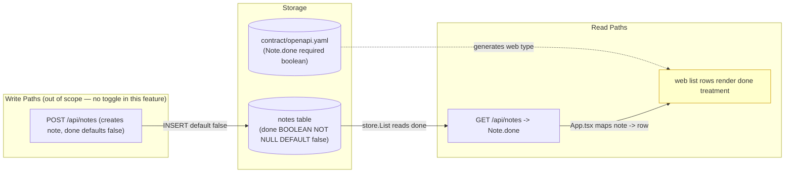
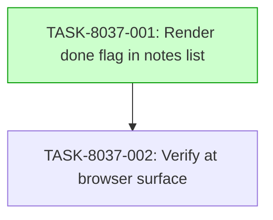

# Implementation Guide — Notes List Done-Flag Visibility (FEAT-8037)

**Request:** Show each note's done flag in the web app's notes list, with done notes clearly marked as done.

**Stack:** generic (React + Vite + strict TypeScript web app; Go API; PostgreSQL).

## Already done and still to do

1. "Show each note's done flag in the web app's notes list" — still to do — `tests/e2e/specs/notes-done.spec.ts:11` The flag is explicitly "not surfaced in the note list UI by this slice"; the web list rows render no done treatment.
2. "with done notes clearly marked as done" — still to do — `apps/web/src/App.test.tsx:438` The list's existing checks cover the "N notes" total and tab title but contain no "Done" label or differentiated-row-style assertion.
3. "the done flag is delivered to the web app per note" — already done — `apps/api/internal/notes/handler.go:26` The `Note` struct answers `Done bool` on every note, backed by the contract (`contract/openapi.yaml`, `Note.done`) and the migration (`apps/api/migrations/0003_add_done.sql`).
4. "the API answers each note's stored done flag" — already done — `apps/api/internal/notes/done_test.go:58` `TestListAnswersEachNotesStoredDoneFlag` proves the stored value is answered verbatim in both directions.
5. "a completed note is never omitted from the list" — already done — `apps/api/internal/notes/done_test.go:112` `TestCompletedNoteIsNeverOmittedFromTheList` answers both a done and a not-done row in read order.
6. "the web note type carries the done flag" — still to do — `apps/web/src/api.ts:32` The web client treats `done` as a required boolean of the note shape, but this file was not among the code stretches supplied, so its presence is not proven by shown code.

## Members of "each note"

- The `Note` schema of the notes API contract — `contract/openapi.yaml:1` (the source of the notes API contract; `apps/web/src/api-types.ts` is generated from it)
- The `listNotes` operation that returns the list — `contract/openapi.yaml:23`
- The Go `Note` struct that answers the flag — `apps/api/internal/notes/handler.go:21`
- The store read that returns each note with the flag — `apps/api/internal/notes/store.go:69`
- The web note type carrying the flag — `apps/web/src/api.ts:32`
- The generated web note type — `apps/web/src/api-types.ts:28`
- The e2e note member shape — `tests/e2e/specs/helpers.ts:5`
- The e2e per-member flag check — `tests/e2e/specs/notes-done.spec.ts:15`
- The contract test pinning the done declaration — `apps/api/internal/notes/contract_done_test.go:44`
- The handler test pinning the flag round-trip — `apps/api/internal/notes/handler_test.go:557`
- The done-behaviour test suite — `apps/api/internal/notes/done_test.go:26`
- The web client test asserting the required boolean — `apps/web/src/api.test.ts:28`
- The web list view test (the surface to change) — `apps/web/src/App.test.tsx:6`
- Not members: `deploy/deploy.sh`, `scripts/keycloak/configure-realm.inside.sh`, `scripts/stack-lib.sh`, `tests/keycloak/test_configure_realm_readiness.sh`, `compose.yaml`, `deploy/profile.yaml`, `apps/api/cmd/api/main.go`, `scripts/check.sh`, `README.md`, `.gitignore`, `tests/e2e/playwright.config.ts`, `apps/api/internal/notes/contract_test.go` — deployment, Keycloak, compose, build, and routing files that merely mention "note"/"notes" and are not members of the note set.

## Deferred Planning Decisions

| Decision point | Chosen default | status |
|---|---|---|
| Review-scope clarification (focus / depth / trade-off priority) | template default: all aspects, standard depth, balanced trade-offs | deferred |
| Decision checkpoint (accept / revise / implement) | template default: implement | deferred |
| Implementation-preferences prompt (approach / execution / testing depth) | template default: recommended approach, auto-detect parallelism, default testing depth | deferred |
| Mode-boundary normalisation: TASK-8037-001 complexity 4 → `task-work` | `task-work` (complexity ≥ 4) | deferred |
| Mode-boundary normalisation: TASK-8037-002 complexity 3 → `direct` | `direct` (complexity ≤ 3) | deferred |
| Smoke-gate activation | omitted: web unit suite (`apps/web/src/App.test.tsx`) lies outside the declared `test_roots` (`tests/e2e`, `tests/keycloak`); one-edit activation is to add a `smoke_gates:` block whose pytest paths sit under a declared root | deferred |
| ASSUM-001 (no API change required) | assumed true — the flag is already delivered per note | deferred |
| ASSUM-002 (single notes list view) | assumed true — change applies to the one notes list view | deferred |
| ASSUM-003 (done treatment = "Done" label + differentiated styling) | assumed as proposed | deferred |
| ASSUM-004 (no reordering/grouping of done notes) | assumed true — done notes keep current position | deferred |
| ASSUM-005 (unset/null treated as not-done) | assumed true | deferred |
| ASSUM-006 (done flag is a boolean-like completed state on the model) | assumed true | deferred |

## AC-quality warnings

None. Every acceptance criterion names an observable surface behaviour (a displayed "Done" label, a differentiated row style, an unchanged title/ordering/total) with no ambiguous phrasing; the set-coverage criterion follows the fixed form and names its member source (`contract/openapi.yaml`).

## Data Flow: Read/Write Paths

_Caption: The read path from storage to the rendered row is the feature's subject. The yellow node (web row rendering) is the only disconnected/missing link — the flag reaches the browser (`R1`) but is not yet surfaced in the row (`R2`). The write path is out of scope (no toggle)._

**Disconnection Alert**: The flag is delivered to the browser but not surfaced in the row. TASK-8037-001 wires `R1 -> R2` by rendering the "Done" label and differentiated styling.

## Task Dependencies

_Caption: TASK-8037-001 builds the surface; TASK-8037-002 verifies it at the browser. No parallelism (single chain)._

## §4: Integration Contracts

### Contract: Note.done (display consumption)
- **Producer task:** none — produced by the existing API/contract layer (`apps/api/internal/notes/handler.go`, `contract/openapi.yaml`)
- **Consumer task(s):** TASK-8037-001, TASK-8037-002
- **Artifact type:** JSON field on each note in the `GET /api/notes` response
- **Format constraint:** `done` is a required boolean (`true`/`false`), never null or a string (per `contract/openapi.yaml`, `Note.done`); the renderer must treat absent/null as not-done (ASSUM-005)
- **Validation method:** TASK-8037-001 unit checks assert the row reflects the `done` value; TASK-8037-002 playwright checks assert the "Done" label and styling at the browser surface

## Smoke Gates

Omitted. The descriptor's `test_roots` are `tests/e2e` and `tests/keycloak`; the web unit suite that would gate the rendering change lives at `apps/web/src/App.test.tsx`, outside those roots, and no positional pytest path under a declared root covers the web rendering. Per the smoke-gate rule, the `smoke_gates:` block is omitted rather than inventing a path outside the declared roots. **One-edit activation:** add a `smoke_gates:` block whose command invokes tests under a declared root (e.g. `tests/e2e`) once the browser spec from TASK-8037-002 exists.

## Verifier Routing

All eight approved scenarios are browser-surface scenarios (a rendered row, a displayed label, a styled row) and route to **playwright**, per the spec's proposed routing. The `scenarios:` verifier-stamp map is decided downstream by the routing-law rules and is intentionally not written here.

## Operator Follow-up

No `operator_handoff` tasks: every acceptance criterion is observable in code or via the deterministic playwright/unit suites — no live infrastructure, human-in-the-loop, or wall-clock waiting is required.