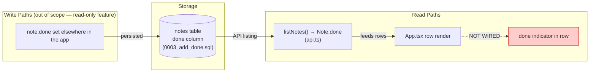
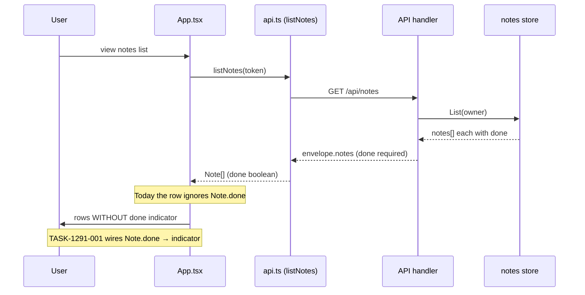
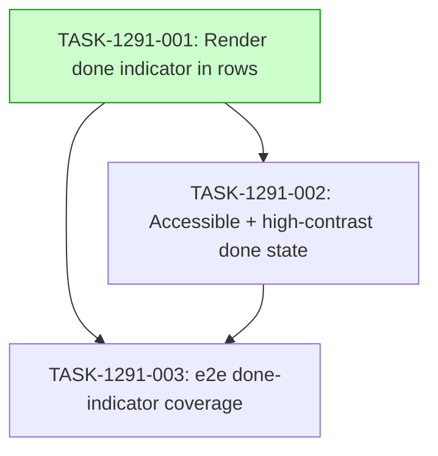

# Implementation Guide — Notes List Done-State Visibility (FEAT-1291)

**Feature id:** FEAT-1291
**Stack:** generic (stack undeclared in the request; recorded as generic rather than guessed)
**Generated:** 2026-07-09T14:32:00Z
**Specification:** `features/notes-list-done-state-visibility/notes-list-done-state-visibility.feature` (15 scenarios)

## Already done and still to do

1. "Show each note's done flag in the web app's notes list" — still to do — apps/web/src/App.tsx:24 the list calls `listNotes(token)` and renders rows, but no shown code proves the row reads or presents the note's done flag; the visual indicator is missing
2. "with done notes clearly marked as done" — still to do — apps/web/src/App.tsx:24 no done affordance (check mark + "Done" label + row-level treatment) is present in the row; the visual distinction beyond the payload is missing
3. "the migration adds the done column to the notes table" — still to do — apps/api/migrations/0003_add_done.sql:3 the migration adds the done column, but this path:line was not in the ranked_source code shown to the planner; treat as still to do pending verification
4. "the API handler answers each note with its own done flag" — still to do — apps/api/internal/notes/handler.go:38 the handler description states each note is answered with its own done flag, but this path was not in the code shown to the planner; treat as still to do pending verification
5. "the API refuses a listing that omits the done flag" — already done — apps/api/internal/notes/handler_test.go:492 `t.Fatalf("note %s: the listing omits the done flag: %v", id, note)` pins that every listed note carries the flag
6. "the web contract carries done as a required boolean" — still to do — apps/web/src/api.test.ts:29 the comment states done is a required boolean of the contract's note object, but this line was not in the code shown to the planner; treat as still to do pending verification
7. "the web API client keeps the completion flag" — already done — apps/web/src/api.test.ts:48 `expect(parseNote({ ...note, done: true }).done).toBe(true);` proves the parser preserves the flag
8. "a note that has never been marked complete still carries the flag" — still to do — apps/web/src/App.test.tsx:34 the comment states a note that has never been marked complete still carries the flag, but this line was not in the code shown to the planner; treat as still to do pending verification
9. "the store returns each note with its completion flag" — still to do — apps/api/internal/notes/store.go:80 the comment says List returns owner's newest notes first each with the completion flag, but this path was not in the code shown to the planner; treat as still to do pending verification
10. "the done indicator appears in the same position on every row" — still to do — apps/web/src/App.tsx:24 no indicator markup exists in the row, so no consistent position can be shown
11. "a note with no explicit done value is treated as not done" — still to do — apps/web/src/App.tsx:24 the row has no logic to default an absent done value to not-done display
12. "the row reflects the note's current stored done flag after a refresh" — still to do — apps/web/src/App.tsx:24 `listNotes(token)` fetches fresh data on each view, but no code shown proves the row reads and presents the flag after refresh
13. "paginated rows carry the done status on every page" — still to do — apps/web/src/App.tsx:24 the row render is the same for every page but no shown code proves the done flag is presented on pages beyond the first
14. "a mixed list renders done and open rows without ambiguity" — still to do — apps/web/src/App.tsx:24 no multi-channel done treatment exists to distinguish a done row from an open row unambiguously
15. "viewing the list does not change any note's done flag" — still to do — apps/web/src/App.tsx:24 no shown code proves the row render is read-only with respect to the done flag; this must be verified and enforced
16. "the done indicator does not displace or truncate existing row content" — still to do — apps/web/src/App.tsx:24 the indicator does not yet exist, so displacement behaviour cannot be confirmed or guarded
17. "the row layout holds at the narrowest supported viewport" — still to do — apps/web/src/App.tsx:24 no responsive indicator layout exists; the row must hold at one mobile-class width (ASSUM-006)
18. "a screen-reader user hears each note's completion status in row order" — still to do — apps/web/src/App.tsx:24 no accessible status announcement is present in the row; only the visual indicator is being added by TASK-1291-001, the a11y layer is TASK-1291-002's scope
19. "the iconographic done indicator adds no duplicate status announcement" — still to do — apps/web/src/App.tsx:24 no accessible naming convention yet exists to keep the icon presentational and the written label the single source of the status readout
20. "done rows remain distinguishable by shape or text in high-contrast rendering" — still to do — apps/web/src/App.tsx:24 no non-colour differentiator (border, underline, persisted text) exists; colour alone currently separates done from open

## Members of "each note"

- The note object the App.tsx list renders, whose `done` flag the row must show — apps/web/src/App.tsx:24 (`listNotes(token).then(`)
- The web API client function that fetches each note with its flag — apps/web/src/api.ts:71 (`export async function listNotes(`)
- The exported `Note` type carrying the required `done` boolean — apps/web/src/api.ts:5 (`export type Note = components["schemas"]["Note"];`)
- The generated API type definitions that define the `Note` shape including `done` — apps/web/src/api-types.ts:28 (`get: operations["listNotes"];`) and apps/web/src/api-types.ts:111 (`listNotes:`)
- The contract that declares `done` on the note object and the `listNotes` operation — contract/openapi.yaml:1 (`# The source of the notes API contract. apps/web/src/api-types.ts is generated`) and contract/openapi.yaml:23 (`operationId: listNotes`)
- The API handler answering each note with its own done flag — apps/api/internal/notes/handler.go:38 (comment: `// The signed-in owner's notes, newest first, each answered with its own done`)
- The store returning each note with the completion flag — apps/api/internal/notes/store.go:80 (comment: `// List returns owner's newest notes first, each with the completion flag the`)
- The store's `List` interface method that returns the note list — apps/api/internal/notes/store.go:24 (`a listed note is never answered without its flag, not even when it is false.`)
- The migration adding the `done` column to the notes table — apps/api/migrations/0003_add_done.sql:3 (`ALTER TABLE notes ADD COLUMN done BOOLEAN NOT NULL DEFAULT false;`)
- The contract test asserting a stored done note is listed with its flag — apps/api/internal/notes/contract_test.go:129 (comment: `// A stored done note is listed with its completion flag: the contract`)
- The contract test logging when the contract does not yet declare `done` — apps/api/internal/notes/contract_test.go:83 (`t.Log("contract/openapi.yaml does not declare Note.done yet: reconciling the flag this task adds…"`)
- The handler test refusing a listing that omits the flag — apps/api/internal/notes/handler_test.go:485 (comment: `// doneFlag answers with the done flag one listed note carries, refusing a`) and apps/api/internal/notes/handler_test.go:492 (`t.Fatalf("note %s: the listing omits the done flag: %v", id, note)`)
- The handler test's listingNotes decoder proving the response body carries the flag — apps/api/internal/notes/handler_test.go:452
- The web API test keeping the completion flag — apps/web/src/api.test.ts:29 (comment: `// done is a required boolean of the contract's note object, so a note`) and apps/web/src/api.test.ts:48 (`expect(parseNote({ ...note, done: true }).done).toBe(true);`)
- The web API test importing listNotes and Note — apps/web/src/api.test.ts:4 (`import { … listNotes, … type Note }`)
- The web app test pinning the never-completed default — apps/web/src/App.test.tsx:34 (comment: `// A note that has never been marked complete still carries the flag.`)
- The web app test asserting collection and title agreement — apps/web/src/App.test.tsx:612 (comment: `// Five notes shown, five notes titled: the title and the list are one`)
- The migrations test pinning the done column is added exactly once — apps/api/internal/notes/migrations_test.go:35 (`var doneColumn = regexp.MustCompile(...)`)
- The App component importing createNote, listNotes, and Note — apps/web/src/App.tsx:3 (`import { createNote, listNotes, SignInRequiredError, type Note } from "./api";`)
- Not members: `deploy/deploy.sh`, `scripts/keycloak/configure-realm.inside.sh`, `scripts/stack-lib.sh`, `scripts/keycloak-config.sh`, `scripts/check.sh`, `scripts/check-feature.sh`, `deploy/profile.yaml`, `.gitignore`, `apps/api/internal/notes/testdata/docker-psql-stub.sh`, `apps/api/cmd/api/main.go`, `apps/api/internal/auth/auth_test.go`, `README.md` — deployment, Keycloak authentication configuration, environment-variable plumbing, build/run scripts, state-directory naming, and infrastructure files that match the word "note" only incidentally (e.g. `NOTES_IMAGE_TAG`, `NOTES_TEST_PASSWORD`, `NOTES_REALM`, `notes-e2e` npm workspace, `notes_live` preview path), not note-data members of the set the request names.

## Deferred Planning Decisions

| Decision point | Chosen default | status |
|---|---|---|
| Review-scope clarification (Context A: focus, depth, trade-off priority) | template defaults (all aspects / standard / balanced) | deferred |
| Accept/revise/implement decision checkpoint | implement | deferred |
| Implementation-preferences prompt (Context B: approach, execution, testing depth) | template defaults (recommend for me / auto-detect / default by complexity) | deferred |
| Mode-boundary normalisation: TASK-1291-001 complexity 5 → task-work | task-work (complexity ≥ 4) | deferred |
| Mode-boundary normalisation: TASK-1291-002 complexity 4 → task-work | task-work (complexity ≥ 4) | deferred |
| Mode-boundary normalisation: TASK-1291-003 complexity 3 → direct | direct (complexity ≤ 3) | deferred |
| Smoke-gate activation: descriptor test_roots are tests/e2e and tests/keycloak, but the feature's unit tests live under apps/web/src/ (not a declared test root); no positional pytest path under a declared root applies | omit smoke_gates block entirely | deferred |
| ASSUM-001 (done flag already on the list payload, no backend change) | implement as presentational-only; read the flag from the existing Note payload | deferred |
| ASSUM-002 (absent done value defaults to not-done) | default absent flag to not-done | deferred |
| ASSUM-003 (done treatment = check mark + "Done" label + muted/strikethrough title) | implement that combination | deferred |
| ASSUM-004 (accessible announcement wording "Done" / "Not done") | use those labels | deferred |
| ASSUM-005 (high-contrast differentiators: border / underline / persisted text label) | keep a non-colour differentiator | deferred |
| ASSUM-006 (narrowest supported viewport is a single mobile-class width) | hold the row layout at one mobile-class breakpoint | deferred |
| ASSUM-007 (single uniform notes list view) | implement one indicator for the single list view | deferred |
| ASSUM-008 (done is a binary state) | render done / not-done only | deferred |
| ASSUM-009 (note model already persists the done flag; read-only here) | read-only display; no schema or write path | deferred |
| ASSUM-010 (done notes remain mixed in the default list view) | keep done notes mixed with open notes | deferred |

## Smoke-gate omission notice

The descriptor declares `test_roots` `tests/e2e` and `tests/keycloak`. The feature's unit tests live under `apps/web/src/` (e.g. `apps/web/src/App.test.tsx`, `apps/web/src/api.test.ts`), which is **not** a declared test root, and the e2e specs are Playwright (not pytest). No positional pytest path in a gate command would be under a declared `test_root`, so the `smoke_gates:` block is **omitted entirely** (Block 6). **One-edit activation:** to arm the feature-level smoke gate, add a `smoke_gates:` block whose `command` invokes the existing Playwright runner over a path under `tests/e2e` (e.g. `npx playwright test tests/e2e/specs/done-indicator.spec.ts`) with `after_wave` ≥ the wave that creates that spec (wave 3, TASK-1291-003).

## Data Flow: Read/Write Paths

**Disconnection Alert**: The read path from the payload (`Note.done`) to the rendered indicator is **NOT WIRED** — the flag reaches the web app but no row presents it. TASK-1291-001 wires this path. The write path is out of scope (the list is read-only with respect to the flag).

## Integration Contracts

The payload already carries `done` end-to-end (contract → client → `Note` type); the only gap is the row render, which TASK-1291-001 closes. No cross-task artifact contract is needed beyond the code dependency (TASK-1291-002 and TASK-1291-003 build on the row TASK-1291-001 produces).

## Task Dependencies

_Wave 1: TASK-1291-001 (foundation). Wave 2: TASK-1291-002 (builds on the row). Wave 3: TASK-1291-003 (tests the delivered surface)._

## §4: Integration Contracts

No cross-task data artifact is produced and consumed between tasks (no env var, config file, or generated schema crosses a task boundary). The dependency is a code dependency: TASK-1291-002 and TASK-1291-003 modify/test the row TASK-1291-001 renders in `apps/web/src/App.tsx`. No `consumer_context` block is required.

## Scenario Ownership

All 15 approved scenarios are owned by building tasks (Block 13): the 12 presentational/behavioural scenarios are owned by TASK-1291-001 (the task that delivers the row surface), and the 3 non-visual-perception scenarios (screen-reader announcement, no duplicate icon announcement, high-contrast distinguishability) are owned by TASK-1291-002 (the task that delivers the accessible surface). The testing task TASK-1291-003 owns no scenario, as required.

## Execution Strategy

- **Wave 1:** TASK-1291-001 (task-work, complexity 5) — render the indicator in `apps/web/src/App.tsx`.
- **Wave 2:** TASK-1291-002 (task-work, complexity 4) — accessible announcement + high-contrast treatment in `apps/web/src/App.tsx`.
- **Wave 3:** TASK-1291-003 (direct, complexity 3) — Playwright e2e coverage under `tests/e2e/specs/`.

Next steps: review this guide, then start with Wave 1 (`/task-work TASK-1291-001`).