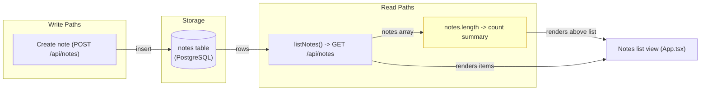
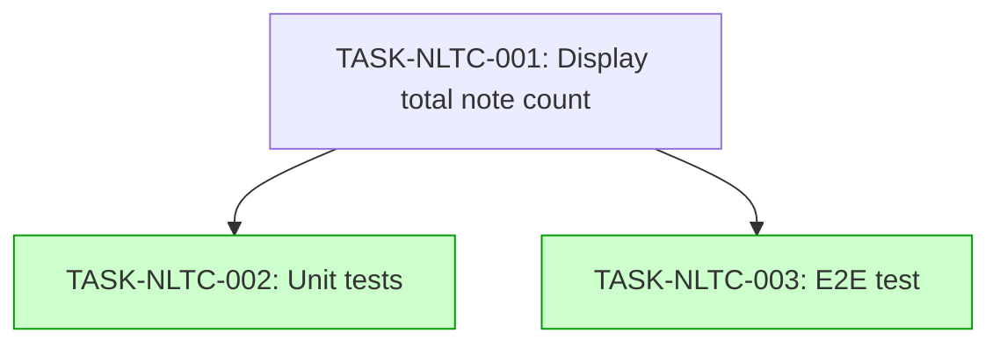

# Implementation Guide: Notes List Total Count (FEAT-8BFC)

## Already done and still to do

- "Show the total number of notes above the notes list" — still to do — nothing found — the notes list view (`apps/web/src/App.tsx`) renders the list of notes but no total-count summary above it; the ranked source shows the notes API returning `{ notes: [...] }` (`apps/web/src/api.test.ts:48`) and the list rendering, but no count element.

## Members of "<phrase>"

Not applicable — the descriptor carries no `sets_the_request_names`.

## Deferred Planning Decisions

| Decision point | Chosen default | status |
|---|---|---|
| Review-scope clarification (focus / depth / trade-off) | Template defaults: focus=all, depth=standard, trade-off=balanced | deferred |
| Decision checkpoint (accept / revise / implement) | implement | deferred |
| Implementation-preferences prompt (approach / execution / testing depth) | Template defaults: recommended approach, auto-detect parallel, testing=default | deferred |
| Mode-boundary normalisation | `implementation_mode` set by complexity (≤3 → direct) for all three tasks | deferred |

## Operator follow-up tasks: 0

(No task requires live infrastructure, a human in the loop, or wall-clock waiting; the line is present only to record the count — N=0, so per the rule it would normally be omitted; recorded here as zero for transparency.)

## Smoke gates

Omitted. The descriptor's `test_roots` are `tests/e2e` and `tests/keycloak` (no Python/pytest roots), so no positional pytest path can be placed under a declared test root. Activation notice: to enable a feature-level smoke gate, add a `smoke_gates:` block to `.guardkit/features/FEAT-8BFC.yaml` whose command invokes the existing e2e runner (e.g. the Playwright suite under `tests/e2e`) — one edit, no path invention.

## Data Flow: Read/Write Paths

The count summary (yellow) is the new read path; it consumes the same `notes` array the list already renders, so no new write or storage path is introduced. No disconnected read path.

## Task Dependencies

_Tasks with green background can run in parallel (Wave 2)._

## §4: Integration Contracts

No cross-task data dependency produces a new artifact: TASK-NLTC-002 and TASK-NLTC-003 consume the rendered surface of TASK-NLTC-001 (the component in `apps/web/src/App.tsx`), not a produced artifact. No integration contract is required.

## Scenario Ownership

| Scenario | Owner |
|---|---|
| Total note count is displayed above the notes list | TASK-NLTC-001 |
| Count is sourced from the same collection that renders the list | TASK-NLTC-001 |
| Count is not rendered inline with list items | TASK-NLTC-001 |

All three scenarios describe the notes list view surface; the building task TASK-NLTC-001 states each at that surface. The testing tasks verify the same surface but do not own it.

## Assumptions carried into the plan (deferred, low confidence)

- ASSUM-001: a notes list view already exists and renders a collection of notes; this feature adds a count to it. The plan modifies `apps/web/src/App.tsx` rather than creating a list.
- ASSUM-002: "total number of notes" means the size of the note set the list is currently showing (view-scoped), not a global per-user total. The count is `notes.length` of the rendered collection.
- ASSUM-003: the count is already available from the list's data source; no new endpoint or query is added.
- ASSUM-004: the count is a non-interactive text summary above the list, not a control/link/sortable affordance.

## Execution Strategy

- Wave 1: TASK-NLTC-001 (direct) — implement the count in the notes list view.
- Wave 2: TASK-NLTC-002 and TASK-NLTC-003 (parallel, direct) — unit and e2e tests for the delivered surface.