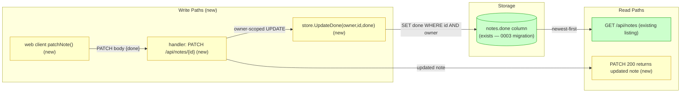
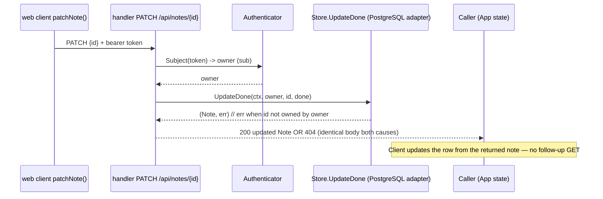
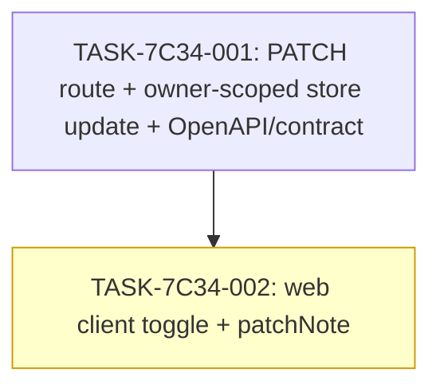

# Implementation Guide — PATCH /api/notes/{id} sets the done flag for the signed-in owner

Feature id: FEAT-7C34 · Stack: generic · Target repo: guardkit/react-go-notes-fixture · Commit: 53fdcd1973867483b0df9bb27c65a44a48755b40

## Already done and still to do

1. "Add PATCH /api/notes/{id} so the signed-in owner can set a note's done flag" — still to do — apps/api/internal/notes/handler.go:38 nothing found — the router registers only `GET /api/health`, `GET /api/notes` and the create route; no `PATCH /api/notes/{id}` is wired.
2. "the signed-in owner can set a note's done flag to true or false" — still to do — apps/api/internal/notes/handler.go:18 the `Store` interface exposes only `Create` and `List`; there is no update method, so nothing on the code side writes the flag. (The listing already answers the flag at `apps/api/internal/notes/handler_test.go:547` — that read is kept.)
3. "it returns the updated note" — still to do — nothing found no PATCH handler returns a note; the note JSON shape the handler reuses is at `apps/api/internal/notes/handler.go:50`.
4. "answers 404 for a note that does not exist" — still to do — nothing found no PATCH route exists, so no 404 path exists yet.
5. "answers 404 for a note that belongs to someone else" — still to do — nothing found owner scoping exists as convention on the read path (`apps/api/internal/notes/handler.go:17`) but there is no owner-scoped update to 404 on.

The done column and its listing already exist (migration `0003_add_done.sql`; listing tests at `apps/api/internal/notes/handler_test.go:518`–`apps/api/internal/notes/handler_test.go:547`). The request's genuine new work is the write path plus its 404 handling; the read side is kept, not rebuilt.

## Data Flow: Read/Write Paths

Every new write path has a corresponding read: the PATCH response itself returns the updated note (R2), and the existing listing (R1) keeps carrying the flag. No disconnected read/write path.

## Integration Contracts

## §4: Integration Contracts

### Contract: PATCH /api/notes/{id} response contract
- **Producer task:** TASK-7C34-001 (adds the route, the OpenAPI PATCH operation, and regenerates `apps/web/src/api-types.ts`)
- **Consumer task(s):** TASK-7C34-002 (web client `patchNote()`)
- **Artifact type:** HTTP operation + generated TypeScript type
- **Format constraint:** `PATCH /api/notes/{id}` with bearer security answers `200` with the `Note` object (`id`,`label`,`createdAt`,`done`), `404` with an identical body for missing/foreign, `401` with the existing challenge, `400` for a non-boolean `done`. The generated type in `apps/web/src/api-types.ts` is the single source the client method is typed against.
- **Validation method:** Coach verifies `contract_test.go` accepts a valid PATCH 200/404 and refuses undocumented/non-boolean fields, and that `api-types.ts` contains the PATCH operation from `contract/openapi.yaml`.

## Task Dependencies

Single-chain plan: the web client (TASK-7C34-002) depends on the route/contract/task-1-owned `api-types.ts` (TASK-7C34-001), so it runs in a later wave. No building task depends on a testing or documentation task.

## Scenario Ownership

| Scenario (verbatim) | Owner |
|---|---|
| Owner marks a note as done and receives the updated note | TASK-7C34-001 |
| Owner re-opens a completed note and receives the updated note | TASK-7C34-001 |
| Updating the done flag leaves the note's other fields unchanged | TASK-7C34-001 |
| The done flag accepts each valid boolean value | TASK-7C34-001 |
| Updating a note that does not exist answers 404 | TASK-7C34-001 |
| Updating a note owned by someone else answers 404 | TASK-7C34-001 |

All six approved scenarios are HTTP-endpoint behaviours delivered at the route, so the route-owning build task (TASK-7C34-001) owns every one; the web client task builds on that surface and is not a scenario owner.

## Smoke Gates

Omitted. The descriptor's `test_roots` (`tests/e2e`, `tests/keycloak`) hold only Playwright e2e and Keycloak shell tests; the feature's verifications live under `apps/api/internal/notes/` (Go) and `apps/web/src/` (TS), which are not declared test roots. A positional pytest path under a declared root cannot be constructed, so per the smoke-gate rule the `smoke_gates:` block is omitted entirely rather than invented. One-edit activation: if the project declares an `apps/api`/`apps/web` test root, a `smoke_gates:` block may then reference it.

## Assumptions carried into the build (all low confidence, human_response: deferred)

- ASSUM-001 — returned note may include a server-managed updated timestamp.
- ASSUM-002 — toggling `done` does not alter `createdAt` (pinned by the "other fields unchanged" acceptance criterion).
- ASSUM-003 — the 404 body carries no information revealing whether the note exists (pinned by the byte-identical-body check).

## Deferred Planning Decisions

| Decision point | Chosen default | status |
|---|---|---|
| Review-scope clarification (review focus / analysis depth / trade-off priority) | All aspects · standard depth · balanced trade-offs (template default) | deferred |
| Decision checkpoint (accept / revise / implement) | implement | deferred |
| Implementation preferences (approach / execution / testing depth) | recommended approach · auto-detect execution · default testing depth | deferred |
| Mode-boundary normalisation: headless port runs no interactive question phase; the three interaction points auto-resolve and are recorded here instead of asked | recorded, not asked | deferred |
| ASSUM-001 (updated timestamp on returned note) | not pinned beyond "returns the updated note"; build must not assert a specific `updatedAt` value | deferred |
| ASSUM-003 (404 body shape) | generic error body via `writeError`, identical across both 404 causes | deferred |
| Web-client control presentation for the done toggle | labelled `button` per existing accessible patterns | deferred |

## Assumption on existing code (Block 10)

The PostgreSQL `Store` adapter's concrete implementation file was not shown among the ranked blocks; the descriptor's `repository_inventory` shows `apps/api/internal/notes/store.go` and the migrations already exist, so the plan extends the existing owner-scoped store with a single `UpdateDone` method rather than planning a new storage layer.