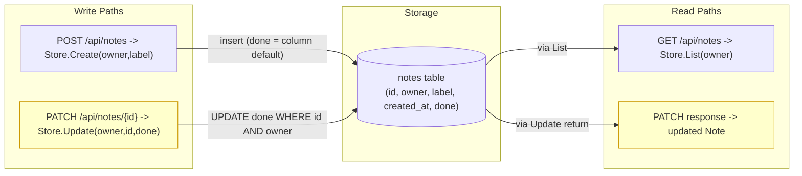
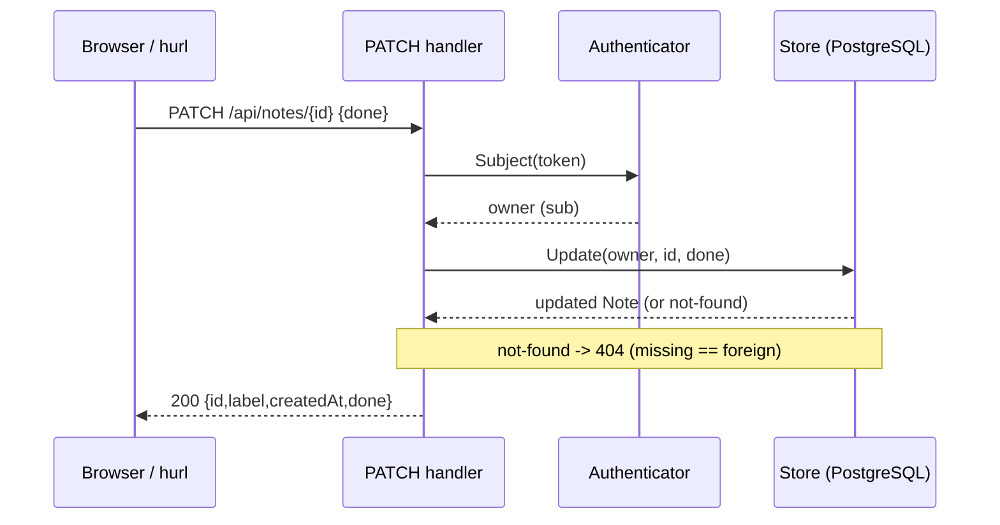
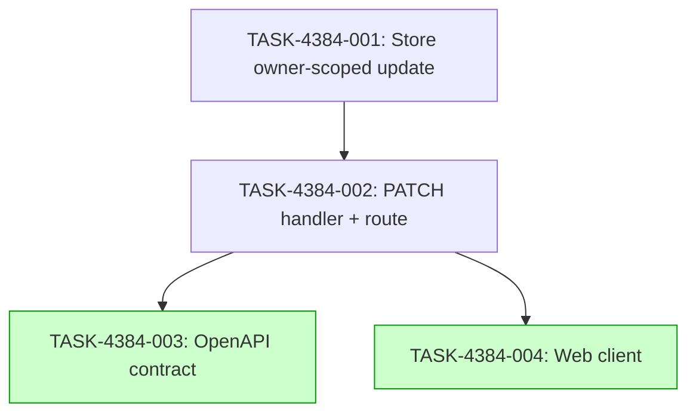

# Implementation Guide — PATCH /api/notes/{id} toggles the done flag for the signed-in owner

**Feature:** FEAT-4384
**Specification:** `features/patch-api-notes-id-toggles-the-done-flag-for-the-signed-in-owner/patch-api-notes-id-toggles-the-done-flag-for-the-signed-in-owner.feature`
**Stack:** generic (Go API + React web)
**Generated:** 2026-07-09T14:32:00Z

## Already done and still to do

1. "Add PATCH /api/notes/{id}" — still to do — `apps/api/internal/notes/handler.go:30` The `Store` interface exposes only `Create` and `List`; no PATCH route or update method exists anywhere in the API.
2. "the signed-in owner can set a note's done flag to true or false" — still to do — `apps/api/internal/notes/handler.go:30` The `Store` interface is scoped to the signed-in owner but offers no update; the done flag is currently written only by the column default of `0003_add_done.sql` and read by `List`.
3. "it returns the updated note" — still to do — `apps/api/internal/notes/done_test.go:32` The `Note` struct already carries `Done bool`, but no endpoint returns a note after a done-flag change.
4. "answers 404 for a note that does not exist" — still to do — nothing found No PATCH handler exists, so there is no not-found path for a missing id.
5. "answers 404 for a note that belongs to someone else" — still to do — nothing found No owner-scoped update exists, so the indistinguishable-404 property is not yet enforced.
6. "the done flag exists on the note and is read by the list" — already done — `apps/api/internal/notes/done_test.go:32` The `Note` struct carries `Done bool` and `TestListAnswersEachNotesStoredDoneFlag` (`apps/api/internal/notes/done_test.go:58`) proves the list answers each note's stored done flag.

## Members of the notes set

The request does not name a whole set ("all the X"), so no set-membership section is required by the descriptor. For completeness, the files that read or write the notes table are already enumerated and self-discovered by the existing check `TestEveryNoteReadFromTheNotesTableCarriesTheDoneColumn` (`apps/api/internal/notes/done_test.go:345`), which walks the repository rather than a hand-written list; the new store update in TASK-4384-001 must keep that check green by reading/writing the done column on the notes table.

## Deferred Planning Decisions

| Decision point | Chosen default | status |
|---|---|---|
| Review-scope clarification (focus / depth / trade-off priority) | template defaults: focus=all, depth=standard, trade-off=balanced | deferred |
| Decision checkpoint (accept / revise / implement) | implement (always resolves to implement in headless mode) | deferred |
| Implementation-preferences prompt (approach / execution / testing depth) | template defaults: recommended approach, auto-detect parallelism, testing=default | deferred |
| Mode-boundary normalisation | `implementation_mode` set to `task-work` for complexity ≥ 4 and `direct` for ≤ 3 (no `manual`/`operator_handoff` tasks present) | deferred |
| Smoke-gate activation | omitted: `test_roots` (`tests/e2e`, `tests/keycloak`) are Playwright/shell roots, not pytest roots, so no positional pytest path can be placed under a declared test root | deferred |
| ASSUM-001 (returned note includes id, label, done) | adopted as specified; human confirmation deferred | deferred |
| ASSUM-002 (success status is 200) | adopted as specified; human confirmation deferred | deferred |
| ASSUM-003 (note id is a string) | adopted as specified; human confirmation deferred | deferred |

## Smoke gates — omission notice

The `smoke_gates:` block is omitted. The descriptor's `test_roots` are `tests/e2e` and `tests/keycloak`, which hold Playwright (`.spec.ts`) and shell tests, not pytest suites; there is no declared pytest test root under which a positional pytest path could sit, so per the smoke-gate rule the block is left out entirely rather than invented. **One-edit activation:** if a pytest test root is later declared, add a `smoke_gates:` object (single command, `after_wave` ≥ the wave that creates the referenced tests) to `.guardkit/features/FEAT-4384.yaml`.

## Data Flow: Read/Write Paths

_New/changed paths (PATCH write and its returned note) are yellow; the existing POST write and GET read are healthy._

**Disconnection Alert**: none. Every write path has a read path — the PATCH write is read back both in its own 200 response and by the existing GET /api/notes (the persistence scenario).

## Integration Contracts

_Data flows onward to the caller in the 200 body; the not-found branch returns 404 with no existence signal._

## Task Dependencies

_Tasks with green background (Wave 3) can run in parallel._

## §4: Integration Contracts

### Contract: Store.Update(owner, id, done) -> (Note, error)
- **Producer task:** TASK-4384-001 (Add the owner-scoped done-flag update to the notes store)
- **Consumer task(s):** TASK-4384-002 (Add the PATCH /api/notes/{id} handler and route)
- **Artifact type:** Go interface method on `Store` (`apps/api/internal/notes/handler.go`)
- **Format constraint:** the method takes the owner (token `sub`), the string id, and the done boolean, and returns the updated `Note` (id, label, created_at, done) or a not-found error; the not-found error is the single signal the handler maps to 404 so missing and foreign notes are indistinguishable.
- **Validation method:** Coach verifies the handler calls the new `Store` update exactly once and maps its not-found signal to 404, and that `TestContractKeepsTheDoneFlagOffTheWritePathAndTheEnvelope` still passes.

## Execution Strategy

**Wave 1** (1 task): TASK-4384-001 — store owner-scoped update.
**Wave 2** (1 task): TASK-4384-002 — PATCH handler + route (depends on Wave 1).
**Wave 3** (2 tasks, parallel): TASK-4384-003 — OpenAPI contract; TASK-4384-004 — web client (both depend on Wave 2).

## Scenario Ownership

All seven approved scenarios are owned by TASK-4384-002, the task that delivers the PATCH /api/notes/{id} surface. The store task (TASK-4384-001) builds behind that surface and owns no scenario; the contract and web-client tasks build on the finished surface.

## Notes on kept project checks

- `TestContractKeepsTheDoneFlagOffTheWritePathAndTheEnvelope` (`apps/api/internal/notes/contract_done_test.go:72`) pins that `NewNote` has no `done` property and `NoteList` has no `done` field. The request does not ask to change this, so every task keeps it: the toggle body carries only `done`, and `NewNote`/`NoteList` are untouched.
- `TestEveryNoteReadFromTheNotesTableCarriesTheDoneColumn` (`apps/api/internal/notes/done_test.go:345`) walks the repository and requires every notes-table read/write member to handle the done column; the new store update must satisfy it (it writes the done column on the notes table).
- The existing end-to-end specs under `tests/e2e/specs/` (journey, notes-done, notes-done-visibility) are the project's own checks; they are not asked to change and must stay green.