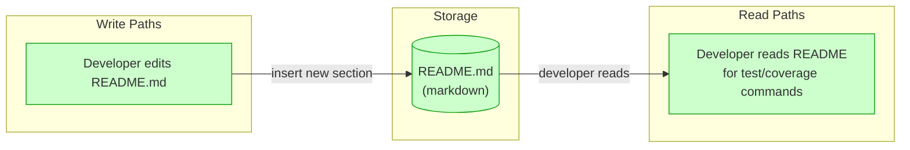
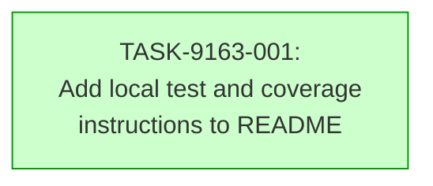

# Implementation Guide — README Test Documentation Update (FEAT-9163)

## Already done and still to do

1. "Add a short section to the README that explains how to run the web app's tests locally" — still to do — nothing found — no ranked block shows the README's current content; the inventory confirms `README.md` exists but its body was not supplied, so the presence of a test-instructions section cannot be confirmed.
2. "Add a short section to the README that explains how to generate the web app's coverage report locally" — still to do — nothing found — same reason; no evidence stretch covers `README.md`.
3. "Using the commands the project already declares" — still to do — nothing found — the ranked blocks do not include `apps/web/package.json`, `scripts/check.sh`, or `scripts/coverage.sh`; the declared command strings are not visible in the supplied evidence.
4. "Change nothing else" — still to do — nothing found — the README's current content is not shown, so the baseline for "unchanged" cannot be verified from the supplied material.

## Deferred Planning Decisions

| Decision point | Chosen default | status |
|---|---|---|
| Review-scope clarification (focus, depth, trade-off priority) | All aspects / standard depth / balanced | deferred |
| Accept / revise / implement checkpoint | implement | deferred |
| Implementation-preferences prompt (approach, execution, testing depth) | Recommended approach / auto-detect parallel / default testing | deferred |
| ASSUM-001 — which configuration file declares the web app's test command | Read `apps/web/package.json` and `scripts/check.sh`; use whichever declares it | deferred |
| ASSUM-002 — which configuration file declares the web app's coverage command | Read `apps/web/package.json` and `scripts/coverage.sh`; use whichever declares it | deferred |
| ASSUM-003 — README exists and is the appropriate location | Accepted; `README.md` is present in the repository inventory | deferred |
| ASSUM-004 — declared commands copied verbatim without modification | Accepted; the task instructs verbatim copy from the authoritative config file | deferred |

## Smoke Gates — Omission Notice

`smoke_gates` is omitted. The descriptor's `test_roots` are `tests/e2e` and `tests/keycloak`; neither contains unit-test paths for the web app, and the web app's test/coverage scripts (`scripts/check.sh`, `scripts/coverage.sh`, `apps/web/package.json` scripts) are not under a declared test root. Per Block 6, the gate block is omitted entirely rather than inventing paths outside the declared roots.

**One-edit activation**: If the project later adds a web-app unit-test directory under a declared test root, add a `smoke_gates` block to `.guardkit/features/FEAT-9163.yaml` with `after_wave: 1` and a `command` whose positional pytest paths are all under a declared `test_root`.

## Data Flow: Read/Write Paths

_All paths are connected. The write is the new section insertion; the read is the developer consulting the README for the two commands._

## Task Dependencies

_Single task, single wave. No cross-task dependencies._

## §4: Integration Contracts

No cross-task data dependencies exist (single task). This section is not required.