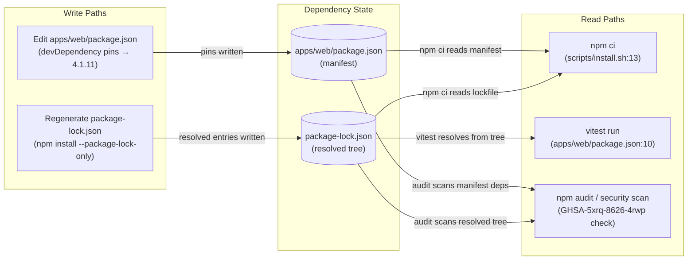
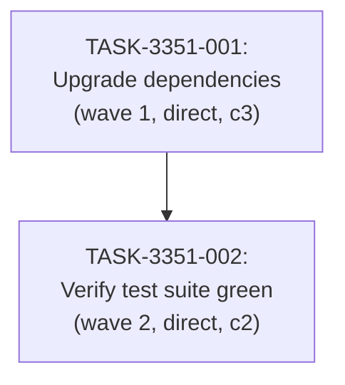

# Implementation Guide: Web App Vitest Security Upgrade (4.0.15 → 4.1.11)

**Feature ID:** FEAT-3351
**Created:** 2026-07-09T14:32:00Z
**Complexity:** 4/10
**Tasks:** 2
**Waves:** 2 (sequential)

## Already done and still to do

1. "upgrade the test tools vitest and @vitest/coverage-v8 from 4.0.15 to 4.1.11 in apps/web/package.json" — still to do — apps/web/package.json:22,29 both devDependency entries still read "4.0.15"; the upgrade to "4.1.11" has not been applied
2. "upgrade the test tools vitest and @vitest/coverage-v8 from 4.0.15 to 4.1.11 in package-lock.json" — still to do — package-lock.json:2058-2061 @vitest/coverage-v8 resolves at 4.0.15; vitest also resolves at 4.0.15 in the lockfile; the lockfile has not been regenerated for 4.1.11
3. "because 4.0.15 has a critical security advisory (GHSA-5xrq-8626-4rwp)" — still to do — apps/web/package.json:22,29 the vulnerable 4.0.15 version is still declared; the advisory is not yet remediated
4. "the resolved test tool versions are exactly 4.1.11 and not a higher 4.x release" — still to do — apps/web/package.json:22,29 entries are at 4.0.15; no 4.1.11 pin exists yet
5. "the vulnerable 4.0.15 version does not survive anywhere in the resolved tree" — still to do — package-lock.json:2058-2061 4.0.15 entries remain in the resolved tree
6. "all existing tests must still pass" — still to do — nothing found the regression gate under 4.1.11 has not been run; the existing test files (apps/web/src/App.test.tsx, apps/web/src/api.test.ts, apps/web/src/config.test.ts) exist and are the suite to verify
7. "no previously passing test fails after the upgrade" — still to do — nothing found the zero-regression check under 4.1.11 has not been executed

## Members of "all existing tests must"

- apps/web/src/App.test.tsx — apps/web/src/App.test.tsx (web app unit test file, discovered by vitest run per apps/web/package.json:10)
- apps/web/src/api.test.ts — apps/web/src/api.test.ts (web app unit test file, discovered by vitest run per apps/web/package.json:10)
- apps/web/src/config.test.ts — apps/web/src/config.test.ts (web app unit test file, discovered by vitest run per apps/web/package.json:10)
- Not members: `scripts/keycloak-config.sh`, `tests/e2e/playwright.config.ts`, `apps/api/migrations/0002_add_created_at.sql`, `apps/web/src/App.tsx` — these files contain the word "existing" in unrelated contexts (Keycloak realm idempotency comment, Playwright reuseExistingServer setting, migration comment about existing rows, React state updater); none is a test file or a member of the test suite the request refers to

## Data Flow: Read/Write Paths



All write paths have corresponding read paths. No disconnections.

## Task Dependencies



Sequential: the upgrade must land before the regression gate runs.

## §4: Integration Contracts

### Contract: package-lock.json consistency
- **Producer task:** TASK-3351-001 (Upgrade dependencies)
- **Consumer task(s):** TASK-3351-002 (Verify test suite green)
- **Artifact type:** file (package-lock.json)
- **Format constraint:** package-lock.json must be fully consistent with apps/web/package.json so that `npm ci --ignore-scripts --no-audit --no-fund` (scripts/install.sh:13) succeeds without the hash guard (scripts/install.sh:9-10) rejecting the install. The vitest and @vitest/coverage-v8 entries in the lockfile must resolve to exactly 4.1.11.
- **Validation method:** Coach verifies `npm ci` exits 0 and `npm ls vitest @vitest/coverage-v8 --workspace sample-web` reports 4.1.11 for both.

## Deferred Planning Decisions

| Decision point | Chosen default | Status |
|---|---|---|
| Review scope clarification (Context A): review focus, analysis depth, trade-off priority | All aspects, standard depth, balanced trade-offs | deferred |
| Decision checkpoint (accept/revise/implement) | implement | deferred |
| Implementation preferences (Context B): approach selection, execution preference, testing depth | Recommended approach (direct edit + regenerate), sequential execution, default testing depth | deferred |
| ASSUM-001: target version pinned exactly at 4.1.11 vs caret range | Exact pin "4.1.11" (no caret), per the request's explicit "to 4.1.11" | deferred |
| ASSUM-002: a passing-test baseline under 4.0.15 exists | Assumed to exist; the regression gate compares against the current suite's pass state | deferred |
| ASSUM-003: moving to 4.1.11 is sufficient closure; no compensating controls | Assumed sufficient; no interim mitigations planned | deferred |
| Smoke gates omitted | test_roots are tests/e2e and tests/keycloak; the vitest unit tests live in apps/web/src/ which is not a declared test root, so no valid pytest/vitest positional path exists under a declared root. One-edit activation: add `smoke_gates: { after_wave: 1, command: "npm --workspace sample-web run test" }` to the feature YAML if the project declares apps/web/src as a test root. | deferred |

## Smoke Gates

Omitted. The descriptor's `test_roots` are `tests/e2e` and `tests/keycloak`. The vitest unit tests that this feature exercises live in `apps/web/src/` (e.g. `apps/web/src/App.test.tsx`), which is not under a declared test root. Per the smoke-gate rule, the `smoke_gates` block is omitted entirely.

**One-edit activation notice:** If the project declares `apps/web/src` (or `apps/web`) as a test root, add to the feature YAML:
```yaml
smoke_gates:
  after_wave: 1
  command: |
    set -e
    npm --workspace sample-web run test
```

## Execution Strategy

**Wave 1:** TASK-3351-001 (Upgrade dependencies) — direct mode, complexity 3
**Wave 2:** TASK-3351-002 (Verify test suite green) — direct mode, complexity 2

Sequential execution. No parallelism available (single dependency chain).

## Next Steps

1. Review: tasks/backlog/web-app-vitest-security-upgrade/IMPLEMENTATION-GUIDE.md
2. Start with Wave 1: TASK-3351-001
3. After Wave 1 completes, run Wave 2: TASK-3351-002
4. Verify the security audit no longer reports GHSA-5xrq-8626-4rwp